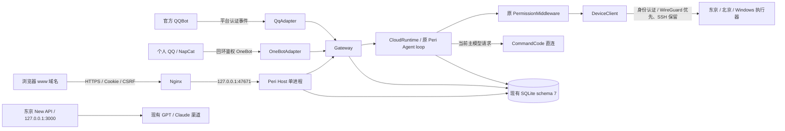
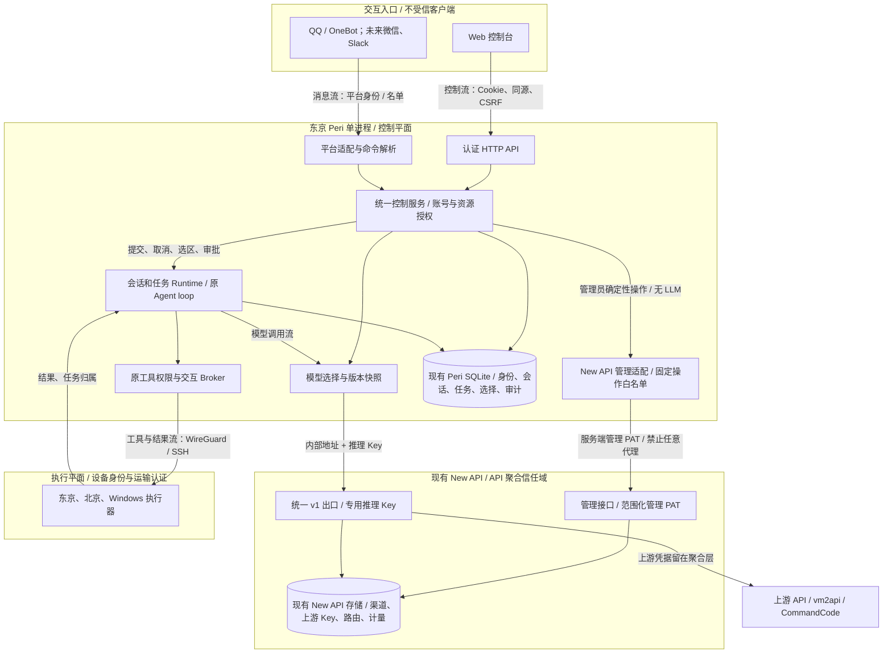

# 长期架构升级：实况审计与实施契约

审计时间：2026-10-17。代码基线：6e5fbe7ccacdd7f0625b514b2c0541026cab7c69（网页拓扑重排，尚未替换线上实例）；线上主控仍为 v0.5.0 / 638bba6。本文依据实际 Rust 路径、东京进程和配置、New API HTTP 响应与固定版本源码。后续实施进度单独记录，不把设计当成交付。

## 阶段一：已核实的系统

### 当前拓扑

实际请求方向不是“API 聚合 → Agent → 设备”的单向管道。消息/网页向主控提交控制请求；Agent 主动调用模型聚合；工具执行发往设备，结果回到同一任务。

### 部署事实

| 项目 | 已核实情况 |
| --- | --- |
| 站点 | 根域名 `claudeoutofdario.icu` 是现有 Meridian/New API；`peri.claudeoutofdario.icu` 反代 Peri（2026-10-18 起，原 `www` 入口停用）。复用现有 TLS 与 Nginx，不替换根站业务 |
| Peri 主控 | 东京 systemd `peri-cloud`，账号 peri-cloud；监听回环 47671；OneBot 47672；已有独立 SQLite 和备份路径 |
| 执行器 | 东京与北京宿主机 root；Windows 当前用户。设备身份和目录独立于网页入口；连接支持 WireGuard 与 SSH 保留通路 |
| New API | 容器 `meridian-portal-new-api-1`，回环 3000，镜像 `meridian-newapi:receipt-0fcb40c55006` |
| 版本 | 实际 `/api/status`：`v1.0.0-rc.41-meridian-receipt1`；镜像标注源 revision `2035a82aeb5414253a728bd937d4b8f97aa99b9b`，其路由和权限与实际读取响应交叉核实 |
| New API 存储 | 已有 Postgres、Redis 与 `/opt/meridian-portal/data`；Peri 不再引入另一套聚合数据库、Redis 或消息队列 |
| 既有渠道 | GPT type 1 和 Claude type 14，共用 vm2api。Peri 当前 DeepSeek 模型仍直连 CommandCode，尚未经过该聚合出口 |
| 资源 | 东京 约 7.9 GiB 内存、4.0 GiB available，根盘约 25 GiB 空闲；这是审计时刻快照，不是容量保证 |

### 功能与入口清单

| 能力 | IM | Web / 后端 | 实现路径 |
| --- | --- | --- | --- |
| 账号、设备登记、聊天关联 | 绑定、菜单；关联需人确认 | 登录、邀请、OAuth 原生授权、关联确认 | `identity/`、`portal/browser.rs`、`portal/native.rs` |
| 工作区与设备选择 | 菜单、/连接、/工作区 | 设备浏览、默认目录、已有会话切换 | `gateway/workspaces.rs`、`portal/workspaces.rs` |
| 工具权限与问答 | 原审批按钮、纯文本详情/允许/拒绝、/回答 | 同一 InteractionHub 的精确请求处理 | `gateway/broker.rs`、`portal/interactions.rs`、`assembly.rs` |
| 状态、取消、结果 | /状态、/取消、/结果 | 状态和结果；复杂任务提交/结构化取消尚待补齐 | `gateway/activity.rs`、`gateway/controls.rs`、`runtime.rs` |
| 入口白黑名单 | 管理员私聊 /网关，持久化、CAS、完整分页 | 管理员页面，同一策略与审计表 | `gateway/access/`、`portal/access.rs` |
| 偏好、限长记忆 | /设置、/记忆、/记住、/偏好、/用量 | 同一 user_data 与 revision | `gateway/personal.rs`、`portal/personal.rs`、`state/userdata.rs` |
| 个人模型 | /模型 可切换已绑定个人供应商的模型 | host.json 固定供应商 + 每账号一个密钥/模型 | `models.rs`、`gateway/personal.rs` |
| 多平台 | 官方 QQ 与个人 QQ/OneBot 已实现并共存 | 同一 MessageAdapter 抽象 | `qq/`、`onebot/`、`gateway/types.rs` |

微信和 Slack 在 Peri 当前代码中没有可交付适配器，不能把设计扩展点写成已有接入。现有 Meridian 的支付/手机监听也不等于 Peri 微信网关。本次保留并加固 MessageAdapter 的共享能力，不虚报新增平台已验收。

### 关键边界与缺口

- `host::serve` 同时装配 HTTP、适配器、身份、模型、Gateway 和 Runtime。模型客户端构造不需要先连通上游；已有离线模型启动测试证明管理入口可在推理不可用时工作。
- Gateway 兼有命令呈现和应用控制服务；workspace、个人资料、名单已共享存储，但尚无清晰命名的统一控制门面。应逐步提取，不能用第二份 Web 业务替代它。
- `CloudRuntime` 拥有任务与恢复；`CloudAgent` 跑原 Peri loop；`PermissionMiddleware` 决定工具审批；运输认证不能替代工具授权。
- `FrozenSession` 绑定单台执行器。聊天手动切换可选新会话；尚无保持同一执行轮次的内置自动切机工具。该升级按 `context-and-model-control-design-20261017.md` 的 segment/epoch 契约单独实施，不能只改 cwd。
- 模型密钥与供应商分散：服务默认直连、个人 user_models 与 New API 各有配置。当前网页不能管理 New API 渠道和统一出口。
- 页面能管理已存在的 QQ 会话，但缺少结构化提交/取消、任务链接和平台连接的真实观测；“已配置”不能显示成“已连接”。
- 普通聊天返回模型文本，模型可能输出 Markdown；管理通知已有纯文本。QQ 普通输出应做保守降级，不破坏代码和完整链接，也不依赖 Markdown 才能使用。

### New API 已验证的能力与限制

实际管理员 GET 已核实：渠道列表、分组、用户可用组、权限目录、管理员资料；凭据均留在服务器，未输出到审计文档或终端。

- 渠道：列表/详情、模型列表、单渠道测试、状态更新、创建、编辑、删除；渠道的模型名与 mapping、group、priority、weight 由聚合层维护。
- 凭据：推理 API Key 与仪表盘管理 PAT 是两类凭据。当前版本支持范围化 PAT，channel 的 read / operate / write / sensitive_write / secret_view 分开。集成不申请 secret_view，不提供上游密钥读取接口。
- PAT 创建需要浏览器会话和针对精确权限集合的安全证明。该部署实际支持密码证明；不能绕过 New API 验证或直接改数据库发令牌。
- 现有运维 client.login 带 `_selflimit`，会撤销其他管理员会话；不能复用该副作用。审计直接使用正常登录端点，服务端满会话时拒绝登录，不踢掉既有会话。
- 组比例实际为 default/gpt 0.25、claude 1.4，并有机构组；零倍率并未部署。源码允许 ratio 为 0，但钱包路径仍检查余额，订阅路径存在最小预扣与特殊处理，不能推断“零倍率 = 永远可调用且没有额度要求”。
- 暂未验证所有模型推理、渠道失败切换以及零倍率完整计量行为；不会把未验证行为作为生产前提。

源码依据：[路由](https://github.com/QuantumNous/new-api/blob/2035a82aeb5414253a728bd937d4b8f97aa99b9b/router/channel-router.go)、[PAT 范围](https://github.com/QuantumNous/new-api/blob/2035a82aeb5414253a728bd937d4b8f97aa99b9b/service/access_token_scope.go)、[计费会话](https://github.com/QuantumNous/new-api/blob/2035a82aeb5414253a728bd937d4b8f97aa99b9b/service/billing_session.go)。镜像有定制，实施时每个使用的接口还需实际响应验证。

## 阶段二：目标架构与产品方案

### 目标与请求方向

Web 与 IM 并列；New API 是模型调用依赖，不是 Peri 的父控制器。网页暂时不可用，IM 原管理命令继续调用控制服务；全部推理端点故障，HTTP 与 IM 的确定性管理继续可用。

### 单一真值与授权

| 状态 | 真值归属 | 不复制什么 |
| --- | --- | --- |
| 设备身份、归属、撤销、目录默认值 | Peri identity / SQLite；目录有效性由目标执行器验证 | 浏览器不单独存设备清单或 SSH 凭据 |
| 会话、任务、审批、结果与恢复状态 | Peri Runtime / journal / InteractionHub | 不用网页轮询状态代替任务事实，不从日志推导任务成功 |
| 工作区与模型选择 | Peri 的账号/会话范围选择，变更有 revision | 活动轮次冻结配置；改一条会话不改另一条 |
| 上游 API Key、base、模型 mapping、group、priority、weight | New API | Peri 不再保存所有上游 Key，不再另造聚合或计费库 |
| 管理 PAT、统一推理 Key | 服务器凭据文件/环境引用 | 浏览器、模型工具参数、URL、日志不返回这些秘密 |
| 渠道与模型可用性 | New API 实际配置与显式测试；结果带时间 | 未测不写“在线”，配置启用不代表可调用 |
| 适配器状态、错误 | 各适配器的受控运行观测 | 不把配置存在当连接成功，不返回原始平台载荷 |

管理员可以管理公共基础设施；普通成员只能管理自己会话、工作区与允许模型。HTTP actor 来自会话认证，IM actor 来自平台身份映射；LLM 不能自己指定 principal 或提升管理权限。Web 所有写操作同源 + CSRF，资源操作再次检查归属。

New API 请求在后端通过固定 loopback origin 发起：不做任意 URL/路径/方法转发；不暴露管理 PAT；响应使用类型化白名单并过滤错误。普通成员不枚举渠道和其他用户计量。源站 Key 由用户录入后写入 New API，不回显；改密钥和删除都有明确确认及审计。

### 推荐聚合方案与备选

| 方案 | 评价 | 决定 |
| --- | --- | --- |
| 新建聚合服务、复制渠道库 | 重复已有路由/计量，增加进程与一致性负担 | 不采用 |
| 根管理员账号 API Key 直接给 Agent | 推理 Key 虽非管理 PAT，仍会混合用量与过大钱包暴露面 | 不作为默认 |
| 专用普通服务账号 + 受限推理 Key + 范围化管理 PAT | 分离管理与调用；可限制模型、组、来源 IP 和额度，维护成本低 | 推荐；通过现有 API 生成，留撤销记录 |
| 专用零倍率组 | 不代表上游免费，也不能未经验证依赖其余额语义；削弱额度保护 | 初期不采用；保留正常计量和显式有限额度 |

初期内部调用走 `http://127.0.0.1:3000/v1`，统一服务 Key 只由 Peri 进程使用；执行器不需要模型 Key。若以后多账号需独立核算，可按账号派生调用 token，是隔离需要的最小例外，不复制上游 Key。

将当前 Peri 使用的 CommandCode 作为新渠道迁入 New API，先保持真实 model_id，再提供稳定别名。验证真实成功调用后再切 Peri 默认出口，保留旧配置的受保护回滚副本；不改动现有商业/朋友渠道的余额、倍率和访问范围。

### 页面按操作对象组织

- 总览：入口 → 主控 → 设备，与侧向模型出口依赖。只聚合当前任务、待办与关键异常，带可操作的诊断链接。
- 会话与任务：选中会话就是操作范围；显示平台、目标设备、目录、权限、模型。结构化任务输入、确认、取消、进度、结果与错误都在同一上下文内。
- 执行设备与工作区：设备池、身份验证时间、默认目录、远端目录浏览；从会话进入时自动带入对应设备和目录。
- 模型与 API：所有用户有允许模型和当前选择；管理员另外有渠道、端点/凭据写入、别名、分组、优先级/权重、启停、显式测试、已支持的用量与诊断。未支持的数据明确显示缺失。
- 消息入口：平台连接观测、个人关联；管理员可进入原有网关名单。白名单、绑定和工具权限分别说明。
- 个人上下文：偏好、记忆与后续 Skill，和基础设施管理分开。
- 服务与诊断：主控/聚合依赖的真实状态、版本、固定类别错误、审计与恢复指引。

使用现有原生 HTML/CSS/JS，按 hash 展示当前对象页面，保留移动端轻导航。复杂表单显示目标与影响；安全上下文链接只含资源 ID，登录后重新授权，绝不把 bearer、API Key 或关联口令当登录凭据放进 URL。

QQ 管理通知坚持纯文本编号与键值对。普通模型输出做保守纯文本降级，保留代码内容、完整 URL 与错误信息。既有原生按钮/编号命令继续有效，网页链接只是复杂操作的可选入口。

### 一致性、可靠性与资源

统一控制门面封装现有 Gateway/Runtime/Identity/Models；先迁移新增结构化操作，逐步收拢旧路径，不为层次漂亮重写 Agent。原有 browser_* 服务不是废弃实现，应成为共用操作的基础。

任务提交使用请求 ID 做幂等，状态从 journal 读取；断开 HTTP 不取消已受理任务。任务取消是请求，不伪报已经停止；未知执行与投递结果不重放。模型按轮次冻结，选择版本与执行 segment 一同记录。

New API 变更串行化本进程管理请求，并用配置投影 hash 检查本页面旧版本；上游没有 CAS 的字段必须明确承认外部并发窗口，修改后重新读取验证，不宣称跨进程原子事务。超时写入标记结果待核实，先读取核对，不能盲重试创建渠道或密钥。

Peri 新增状态继续使用现有 SQLite，只有需要持久化的选择、审计、幂等记录才加表。不新增 Redis/队列/微服务；后台任务有界。诊断按需读取，不每 5 秒测试所有上游。控制调用有超时、响应大小限制与独立并发上限。

### 分阶段实施与恢复

1. 保留 6e5fbe7 的已测拓扑/连接检查基线，完成本次审计与接口契约。
2. New API 后端适配 + 模型/渠道管理页，先在模拟服务上验证鉴权、脱敏、失败和幂等，再配置专用凭据和当前模型迁入。
3. 统一会话控制门面、结构化任务、取消和模型选择；QQ 与 Web 共用，不移除任何原命令。
4. 连接观测、纯文本输出与诊断深链接；整体验收后发布和替换主控。
5. 自动切设备、分层记忆、渐进 Skill 沿既有独立设计继续推进；不在本轮偷偷打开云端本地目录技能。

部署复用 `www`、TLS 和现有 systemd。先 `--check-config` 以真实运行账号验证，再备份配置与 SQLite，确认无活动任务后切换带 commit 标识的 release 目录。schema 未变时回滚二进制与配置但保留新 journal，避免抹掉已受理消息；schema 升级则优先前向修复，只有明确停机/无新写入且兼容性要求时才使用成对备份恢复。New API 渠道迁入有独立变更清单和 API 级撤销步骤，不通过重置其数据库回退。

Windows 跑回归、格式、Clippy 与 DOM 测试；Linux 只构建与启动/认证 smoke，不重复整套 Windows 测试。生产验证包括原 QQ 命令、精确审批、模型故障下管理、账号隔离、真实统一出口调用与回滚检查；无法进行的人机平台操作明确列为未验收。

## 阶段三：已经落地的控制闭环

- 新增 aggregation 固定操作服务：目录、会话/账号模型选择、渠道管理、幂等与审计；普通管理不依赖推理。它是可选的外部 New API 适配，不是 Peri 内置聚合服务。独立部署默认保留自己的 URL、Key 和协议配置，并支持管理员在网页填写 OpenAI/Anthropic 直连。
- task_control 提取共用准入：原 IM 与网页共同调用 submit_session_task；网页独立工作区使用认证派生身份，不伪造 QQ 事件。相同 request_id 不重复执行，HTTP 断开后主控继续持有任务；QQ 已有会话的任务可以由网页发起并由 QQ 取消。
- 原 PermissionMiddleware、InteractionHub、设备运输身份仍为执行边界。网页只呈现和提交操作，未新造 Agent loop。
- 页面按当前对象分区；原生表单配置任务、目录、模型和渠道，资源 ID 链接延续上下文；移动断点沿用原生 CSS。QQ 输出做保守纯文本降级，不改 journal 中原始回复。
- 新增适配器连接观测；OneBot 只报告桥鉴权，不伪称个人 QQ 在线。设备连接检查仍为显式只读操作。
- schema 8 仅新增四表，模型本轮记录与后续选择分开；工作区切换继承该会话显式选择。旧任务无快照时不补造历史。
- 东京专用服务账号、内部组、调用 Key 与范围化管理 PAT 已通过 New API 正式接口配置；DeepSeek 真实统一出口调用已成功。生产 Peri 主控的替换尚须以最终发布验收记录为准。

接口、凭据隔离、独立部署与恢复步骤见 [控制接口与运维](control-operations.md)。自动切设备、四层记忆与渐进式 Skill 仍是独立设计，未计入本轮已实现功能。
