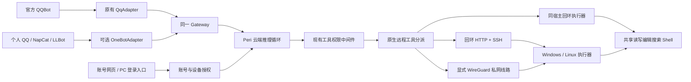

# 架构与权限

## 模块

| 模块 | 职责 |
| --- | --- |
| peri-cloud | 云端推理宿主、身份、账号网页、可选网关、计划任务应用适配 |
| peri-scheduler | 独立时间模型、原子触发与持久派发恢复；不依赖 Agent、记忆、设备或 QQ |
| peri-executor | 原生工具执行、任务日志、本机 OAuth 登录、设备发起的 SSH 隧道 |
| peri-remote-tools | 云端的原生远程工具协议与分派 |
| peri-tool-runtime | 两端共享的文件与 Shell 工具实现 |
| peri-acp-types | 身份、交互和设备执行的公共数据契约 |
| peri-agent / peri-middlewares / peri-model | 原有推理循环、权限和模型接口 |
| peri-config / peri-time / peri-mcp-core / mcp-packages | v4 配置、时间、MCP 核心与内置能力包 |
| peri-process / peri-resources / peri-workflow / peri-js-runtime | 上述模块需要的基础依赖 |

发布源码还保留 `peri-acp/prompts` 中被编译期引用的提示词资源；不包含 ACP 宿主、TUI 或其界面代码。

## 账号、设备与连接

电脑登录使用 OAuth 授权码与 PKCE S256，通过临时回环回调完成本机授权确认。身份、运输连接与工具权限各有不同职责：

- 账号网页决定哪个设备与聊天账号属于你。
- SSH / WireGuard 线路配置与运输令牌决定云端如何认证、连接执行器。
- 当前聊天会话的 Peri 权限模式决定哪些工具需要审批。

OAuth 不把 SSH 用户名、私钥或运输令牌自动塞入工具参数。模型只收到必要的工具参数；实际执行连接由宿主持有。每次任务冻结设备与工作区，切换设备不会改变正在执行的旧任务。

同一设备可以同时提供 WireGuard 和 SSH 线路，选择和恢复连接由宿主处理；线路切换保留执行器身份与任务不确定状态。只有查询可以自动重试，执行请求不会因切换线路而重放。详见[执行器连接与控制面迁移](transports.md)。

QQ 绑定口令五分钟有效、只能使用一次。发送口令只生成关联申请；最后由已登录的电脑账号核对完整聊天身份并确认。

首次账号成为管理员，升级既有数据库时保留原第一个账号为管理员。后续成员通过管理员生成的 24 小时一次性邀请注册。邀请只保存摘要，注册和撤销由事务控制。

用户是隔离边界，可以拥有多个聊天身份；平台和设备没有固定映射。每个聊天路由从本人的设备池选择目标。会话、历史、审批、个人上下文、模型凭据、用量和默认目录按内部 principal ID 归属，该 ID 来自已验证的身份，不接受模型或网页指定其他用户。

服务器本地实例只分配给原管理员；若设备 UUID 已属于其他用户或外部实例，启动失败，不改变原归属。成员不能创建邀请或关闭服务。

## 工作区

“实例”是可以执行工具的目标，协议保留原 device UUID。`local_instance` 为兼容选项：宿主持有同一套执行器、随机回环端口、运输令牌及独立任务日志，以云服务系统账号运行，仅管理员可用。`isolated_instance` 连接独立 Linux 执行器；配套容器只挂载专用工作区和执行器状态，不挂载云端账号、模型凭据或历史。这两个选项互斥；外部执行器仍需本机 OAuth。

每个实例有一个持久默认（全局）目录，账号设置优先于执行器初始登记目录。更新默认目录不改写当前会话；之后未指定路径的选择使用新的默认值。目录发现是认证后的控制接口，只列出目录、父目录和系统根，分页、有界，路径由目标操作系统验证和规范化；它不经过模型，也不新增一次工具审批。

菜单动作由网关存储的随机 UUID 标识，绑定账号、适配器、发送者及聊天路由，四分钟有效，只消费一次。改变选择或权限还必须匹配生成卡片时的预期会话。菜单投递和动作持有沿用现有部署所有权与持久发件箱。QQ 的按钮回复使用官方支持的 `INTERACTION_CREATE` 事件引用；普通消息和数字选择使用各自的新消息引用，保留既有回复去重语义。[QQ 官方协议](https://github.com/tencent-connect/bot-docs/blob/main/docs/develop/api-v2/server-inter/message/send-receive/send.md)

数据库 v4 增加默认目录与菜单表，v5 增加角色、邀请、个人上下文和用量，v6 增加个人模型配置，v7 增加公共网关访问策略、设置输入与修改审计。升级前保存一致的 SQLite 备份；回退程序必须同时恢复对应旧 schema 的状态快照。

路径选择属于账号 / 会话控制，不进入运输配置。QQ 支持 `/工作区` 和带绝对路径的 `/连接`；网页从认证账号解析当前聊天路由，请求只提供预期会话 ID 与目录。执行器验证并规范化目录后，网关新建冻结会话，保留权限模式，再提交路由选择。原会话与历史不改写。

切换和入站路由共用账号级串行门，不同用户互不等待；连接缓存按设备加锁。浏览器切换任务由部署者持有，即使 HTTP 断开也完成结算。设备/目录切换仍拒绝过期会话 ID、已撤销身份和设备、运行中或未确认执行；显式新建或选择独立逻辑会话保留原轮次与绑定，不改写原任务。历史目录和当前选择在重启后恢复。

## 审批

云端沿用 PermissionMiddleware。执行器不实现第二层工具审批，但验证运输认证、协议、工作区与任务身份。

QQ 按钮允许点击到达网关。后台使用平台观察到的发送者、聊天路由和待审批请求验证归属，拒绝错误账号、过期请求和重复提交。网页使用会话 Cookie、CSRF 及同源验证。

QQ 卡片只提供限长摘要，Write / Edit 正文留在登录后的完整参数中。多项工具操作保留总数与详情入口，不把部分预览当作整批授权范围。

## 运行生命周期

账号身份、逻辑会话与消息入口分别保存。网页可通过幂等的会话选择接口新建或选择本人会话；QQ 使用 `/new`、`/resume`。选择进行中的会话不会替换该轮的回复来源和 broker；普通新输入进入持久 FIFO，在上一轮完成且执行状态已结算后重新绑定入口并受理。控制操作仍走认证后的原控制面。执行任务会话不作为普通聊天会话开放。

主助手与执行 Agent 都复用云端原推理循环，执行 Agent 使用独立历史和冻结的设备、工作区。持久任务账本保存生命周期，Agent 只能更新工作计划、备注和消息应用回执。主助手保留 Todo 与原生工具；后台使用独立并发额度，通过任务工具异步委派、取消、查询及双向通信。自动 trace 保存有界的工具输入、结果预览和可见说明，不采集内部思考。完成事件作为带类型的提醒进入原主会话，普通聊天仍只显示主助手的 AI 正文。

任务归属依赖账号和冻结设备，已受理任务不依赖旧网关继续绑定。投送仍重新认证入口；旧入口不可用时，仅选择同账号选中原主会话、支持主动发送且满足隐私边界的其他入口。浏览器审批按真实 principal、session、device、turn 和一次性请求校验；平台回调额外校验原入口和当前会话选择。工具批准仍由原 PermissionMiddleware 决定。

`ContextAssembler` 装配基础提示词、角色、SOUL、渠道规则、记忆协议、外置 Markdown 和原生工具。装配顺序可配置，权限链顺序不受影响；既有记忆帧和工作区能力保留动态刷新契约，不扩展未完成的 MCP、Skill 或自我进化业务。用户文件按可信 principal 隔离，私人文件不进入群聊。

schema 16 增加会话 FIFO、任务账本、任务消息、trace、设备修改占用和共享聊天投影。首版按设备协调 Write、Edit、Bash，后台任务预占设备；状态不明时保留占用，不将未知副作用自动重放。配置、API 与验证状态见 [Agent 核心重构](core-agent-refactor.md)。

schema 17 将逻辑执行会话、稳定执行身份和物理上下文窗口分开登记，任务不再独占 worker_session。主助手通过 list_execution_sessions 发现候选，通过 delegate_task.execution_session 显式选择复用；同窗口的任务按持久顺序串行受理。复用核验 OAuth principal、设备、执行器规范化工作区及文件系统身份、私聊/原公共受众、记忆隐私代次及所有来源主会话的上下文代次。新的主会话权限应用于下一项任务，既有调用和审批仍保留实际轮次归属。换窗与恢复的完整落地进度见 [执行连续性计划](execution-continuity-plan.md)。

schema 18 增加任务检查点与独立操作账本，保存模型边界、派发意图及整批结果落账后的快照与回执。inspect_task.operations 提供有界操作证据。检查点不证明执行器空闲，自动恢复与窗口轮换仍在实施，不能据此重放未知调用。

schema 19 增加任务轮次与真实执行器调用身份、原始/对账回执及模型观察水位。协作暂停、外部等待、主助手回复唤醒和窗口轮换共用检查点恢复路径；只有核验原绑定和原操作后才能受理后续轮次，404 或失联不能触发重放。主会话保留摘要压缩，执行会话改用有界接班和旧窗口检索；旧执行窗口始终不作为普通会话开放。当前契约及实施范围见 [执行连续性](execution-continuity.md)。

schema 20 为执行 agent 接入主助手自动审批代理，schema 24 改为主会话类型化审批信箱及完整呈现回执。原 PermissionMiddleware 继续校验并落实决定，审批事件由主会话串行处理；短控制回合仅有协调工具，并限制推理时间。完整参数、真实归属、指令水位、期限和一次性决定保存到账本；删除/替换内容先通过原发件箱确认通知，投递未知不重发也不执行。详见 [任务审批](task-approvals.md)。主助手直接工具的原权限策略和 OAuth 人工授权流程保持不变。

SQLite 日志记录入站消息、会话、云任务、审批、执行器任务及发件状态。任务 ID 用于去重和恢复查询。连接进程创建不等于在线，只有通过认证与协议校验的执行器才能被选中。

服务停机先停止接纳任务，再结算自己拥有的工作。未知执行结果保留恢复状态；未知发件结果不自动重投。杀进程等强制中断不能当作成功取消。

## 用户配置与资源边界

每日任务额度与入站任务在同一事务中扣除，重复请求只返回原回执。全局和个人活跃任务数有上限，原会话仍串行执行。时限向原推理循环及审批发送取消信号，再结算执行器已有任务，不通过丢弃 future 假装 Shell 已结束。

每次逻辑模型调用及上下文压缩扣除个人请求额度；按 UTC 自然日重置，内部 HTTP 重试不另计次数。这不是 token 或金额计费，也不限制历史数据库总量。

个人供应商由部署者列出，用户只提交供应商 ID、模型 ID 和密钥。每轮快照自己的模型和个人上下文，修改从下一轮生效。密钥只保存在受保护的云端状态目录，不回显、不进入工具参数；数据库和备份属于敏感材料。

云端记忆以账号条目为真值，偏好单独保存。固定 SearchMemory/GetMemory/AddMemory/UpdateMemory/ForgetMemory 工具绑定可信账号和经核验的范围；逐条 CAS 和账号 generation 防止覆盖与旧请求复活。FTS5 使用应用层中文单字/双字与 ASCII 词元，精确子串补充短词与路径查询。正文、索引和无正文审计在同一事务变更，遗忘保留 tombstone。写入继续经过现有 PermissionMiddleware。私聊与认证网页才注入个人资料，私人或旧版会话不能恢复到群聊；定时回合只读当前记忆。容量、迁移与 API 见 [记忆系统](memory.md)。

## 消息与工具扩展

网关适配器负责各平台的消息归一化和投递，不拥有推理循环。QQ 只是当前适配器；添加微信时可以复用账号、会话和审批基础设施。

官方 QQBot 适配器继续保留。个人 QQ 账号接入按新增可选 OneBot 适配器设计，允许两者并存，不替换官方接入、不引入第二套 Agent。官方 OpenID 与个人 QQ 号使用不同适配器命名空间，各自完成账号关联；不能按相同昵称或数字自动合并身份。OneBot v11 反向 Universal WebSocket 已实现为独立可选监听，文本菜单、引用编号、审批和结果复用原有网关；真实 QQ 扫码与客户端显示仍需验收。部署与恢复语义见 [个人 QQ 接入](onebot.md)，设计依据见 [QQ 菜单与个人账号方案](qq-menus-and-personal-bots-20261016.md)。

菜单视图从完整 MenuCard 生成分页正文，按钮标签仅是入口，不承载完整名称的唯一副本。分页固定持久发件 ID，通过当前账号与精确聊天路由读取，不刷新、消费或恢复操作令牌；过期菜单仍可查看文字，但操作继续受原有过期、会话和提问版本检查约束。

远程工具协议为其他工具留有扩展空间，当前注册核心读写、编辑、文件查找、内容搜索和 Shell；个人条目记忆及中文检索在云端处理。USER/FLEET/DEVICE_ENV 范围记忆、版本化模型帧及隐私上下文隔离复用云端账号权限；独立项目授权、后台提炼及 Wake-on-LAN 节点尚未交付。

## 设备工作区与云端能力装配

云端 Agent 继续使用 Peri v4 的中间件链，但只装配能在认证边界内工作的槽位。Web 搜索/抓取由部署环境显式配置端点后启用，沿用 WebSearch/WebFetch 的审批规则；TodoWrite 只维护会话计划，不引入第二个 UI。Goal 以会话为单例持久化在 CloudJournal（schema 14），由 deferred `goal` 工具创建、完成、阻塞或清除，ToolSearch 负责发现与执行。

设备绑定时，执行器提供只读工作区接口：项目指令候选（`AGENTS.md` → `CLAUDE.md` → `.claude/AGENTS.md`，另加 `CLAUDE.local.md`）、`.claude/skills` 下的 `SKILL.md` 目录，以及按已发现项读取正文。接口沿用现有 Bearer 认证，复核会话绑定与工作区身份，只接受工作区相对路径并拒绝符号链接、父目录逃逸和越界；云端不读取主控文件系统。指令按会话冻结；技能工具按需从同一设备读取正文，加载技能不授予执行权限。当前不展开 `CLAUDE.md` 的 `@import`，技能覆盖项目 .agents/skills / .claude/skills 及明确安装的账号、管理员技能；实际归属见上下文装配契约。

MCP 服务按账号保存在 CloudJournal（schema 15），每个会话的池只含该账号启用的服务，不读取主控配置文件、builtin 实例或 stdio。`/mcp` 只接受公网 HTTPS 端点，拒绝 URL 凭据、查询参数、回环/内网/保留地址，HTTP 重定向一律不跟随；不保存 MCP 凭据，因此当前不支持需要 OAuth 或自定义头的服务。MCP 工具保留 `mcp__` 前缀审批，`ExecuteExtraTool` 在派发前解析真实目标，包装工具不能绕过审批。

## 网关访问控制

来源准入由同一个 Gateway 执行，位于身份关联与 Agent 之前，并覆盖按钮回调及发件检查。新增适配器默认采用拒绝式白名单；官方 QQBot 显式保留原接入策略，管理员可再修改。适配器只提供可信发送者、会话分类、标识格式校验和首次引导规则，不拥有独立的权限引擎。白名单和黑名单不授予 Peri 账号归属或工具权限。菜单修改仅允许已关联的管理员私聊，采用持久版本校验与事务审计。配置不覆盖已保存策略；完整规则与恢复说明见 [网关访问控制](gateway-access.md)。

## 原生命令控制面

原生 CommandRegistry/CommandHandler 契约由服务器组合根装配，QQ 与认证 HTTP 共享会话执行能力；目录明确区分 available、limited、adapted、unavailable。耗时命令继续由 Runtime 持有，历史与 flags 经原 Journal 原子结算。clear/rewind 不依赖模型可用性；compact 复用 Agent 的摘要生成逻辑，不在主控读取远程 cwd。具体协议、兼容范围和扩展方式见 [QQ CLI 命令](qq-cli-commands.md)。

## 调度与主动聊天

调度库通过 `Scheduler::apply / inspect / run` 提供托管入口，`Clock`、`SchedulerStore` 与 `TaskDispatcher` 是替换端口。CloudJournal 的唯一进程所有者提供内嵌 SQLite 连接；调度元数据使用独立 `scheduler_metadata`，不修改宿主 `user_version`。云端 schema 11 增加任务引用、全局受理映射和联系设置；旧 schema 10 工作稿保持 `LegacyFrozenSession` 绑定，不静默拓展授权范围。

Schedule、Occurrence、Runtime Turn 与 Delivery 分开记录。云端先查询 `(owner, occurrence_id)` 原受理映射，再为新触发解析当前会话；映射、轮次与额度原子提交。受理未知先查原回执，执行未知继续占用会话；发送未知沿用原发件箱且不重投。

聊天任务绑定已授权的聊天路由，设备任务冻结原会话、设备和工作区。`FrozenSession.device_id` 和 `binding` 同时为空表示明确的云端对话，两者必须成对存在或成对缺省。纯聊天继续使用原 Runtime、个人偏好、条目记忆快照和 PermissionMiddleware，能力表不含设备工具；设备恢复后可重新装配原设备能力。聊天消息投递前复核账号、路由、联系设置、有效期与 `context_generation`；清空或回退上下文使旧代次未发消息失效。

独立二进制提供规则检查与触发时间预览；常驻远程调度宿主尚未启用，需另行验收认证受理协议、唯一状态所有权及迁移流程。见 [调度器运行与接口](scheduler.md)。

## 产物与验收

schema 21 为原操作保存受理时的指令水位。任务 JSON 分开保存产物位置及版本、实际验证回执、未验证项和主助手验收结论；执行完成不会自动接受。宿主校验实际操作归属、结构化执行结果、证据版本和最新要求。已完成任务允许追加要求并显式恢复；旧验收保留但失效。接口和快照边界见 [任务产物与验收](task-deliverables.md)。

schema 22 增加主会话本轮的不可变设备目标，以及主/执行 agent 共用的原生操作账本。解析时固定真实设备、规范工作区、具体参数和原调用身份；权限审批显示实际目标，连接配置仍归宿主管理。小操作不创建委派任务；未知执行从原绑定查询，修改占用与执行任务共用。见 [按调用选择设备](device-invocations.md)。

schema 23 持久保存原生操作的单次取消请求。执行窗口可在原生工具仍运行时替换；新窗口通过引用查询，原结果在原窗口归属下结算，修改占用保留到确认结束。循环结束而旧工具未结算时使用 waiting_operations，不能提前完成或验收。初始记忆屏障保持原历史排除，仅在任务授权仍有效时重新装配宿主交接；真实遗忘会使任务失效。见 [执行连续性](execution-continuity.md)。

## 执行架构完整契约与验收

执行任务、执行会话、运行轮次、物理窗口与原生操作账本分别持久化。审批/通知等待释放后台推理额度，获批后经 waiting_capacity 重新受理；运行中修改仍保留实际设备占用。私人任务保存真实记忆有效期，到期禁止从旧接班材料恢复。历史检索提供完整性标记与有界分页；同一显式共享执行会话允许只读相关任务，不授予跨主会话修改权。运行契约见 [执行连续性](execution-continuity.md)、[主助手审批](task-approvals.md)、[跨设备调用](device-invocations.md) 和 [产物验收](task-deliverables.md)；逐项实现、模拟模型/真实执行器联调及限制见 [完整验收记录](execution-continuity-verification.md)。

## 上下文装配与设备观察扩展

上游核心基线现为 `e598d178`。Cloud schema 25 增加会话绑定的原文恢复副本，主会话 Micro Compact 可收起已闭合、已被模型读取且可恢复的工具交换，Full 继续生成摘要。`ReadContextArchive` 按预算和游标读取，重新核对用户、会话代次、隐私 epoch 与有效期；隐藏推理不通过工具暴露。云端只接入窄归档端口，原 CloudJournal、持久任务和操作账本继续拥有状态权威。异步任务结果另存模型消费回执，投递、模型处理、任务验收和渠道送达分别结算。远程执行器继续校验冻结目录身份。范围与验证见 [本次上游同步记录](upstream/peri-e598d178.md)。

ContextAssembler 保留来源、角色、大小及版本清单，支持每来源累计预算与总预算；base/role 只执行已注册的一层宏替换。SOUL 属于助手层，cwd 优先 AGENTS.md，再回退 CLAUDE.md，local 是独立补充。全局 Skill 按 operator/account 明确安装，项目 Skill 来自认证工作区；只注入目录，正文按需读取。环境快照通过独立认证只读接口取得，并校验原 binding，不创建 job 或执行探测命令。MCP 延续账号明确配置和现有权限链。完整契约、范围与验证见 [上下文装配](context-assembly.md)。
提示词规则由宿主承接：主会话类型化审批、完整活跃约束快照、原调用回执复用、空工具摘要、QQ Markdown 降级和生效 Skill 目录。实现边界见 [宿主契约](prompt-host-contracts.md)。
