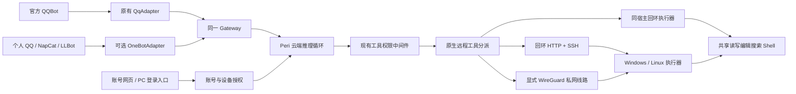

# 架构与权限

## 模块

| 模块 | 职责 |
| --- | --- |
| peri-cloud | 云端推理宿主、身份、账号网页、可选网关、持久化调度 |
| peri-executor | 原生工具执行、任务日志、本机 OAuth 登录、设备发起的 SSH 隧道 |
| peri-remote-tools | 云端的原生远程工具协议与分派 |
| peri-tool-runtime | 两端共享的文件与 Shell 工具实现 |
| peri-acp-types | 身份、交互和设备执行的公共数据契约 |
| peri-agent / peri-middlewares / peri-model | 原有推理循环、权限和模型接口 |
| peri-process / peri-resources / peri-workflow / peri-lsp / peri-js-runtime | 上述模块需要的基础依赖 |

发布源码还保留 `peri-acp/prompts` 中被编译期引用的提示词资源；不包含 ACP 宿主、TUI 或其界面代码。

## 账号、设备与连接

电脑登录使用 OAuth 授权码与 PKCE S256，通过临时回环回调完成本机授权确认。身份、运输连接与工具权限各有不同职责：

- 账号网页决定哪个设备与聊天账号属于你。
- SSH / WireGuard 线路配置与运输令牌决定云端如何认证、连接执行器。
- 当前聊天会话的 Peri 权限模式决定哪些工具需要审批。

OAuth 不把 SSH 用户名、私钥或运输令牌自动塞入工具参数。模型只收到必要的工具参数；实际执行连接由宿主持有。每次任务冻结设备与工作区，切换设备不会改变正在执行的旧任务。

同一设备可以同时提供 WireGuard 和 SSH 线路，选择和恢复连接由宿主处理；线路切换保留执行器身份与任务不确定状态。只有查询可以自动重试，执行请求不会因切换线路而重放。详见[执行器连接与控制面迁移](transports.md)。

QQ 绑定口令五分钟有效、只能使用一次。发送口令只生成关联申请；最后由已登录的电脑账号核对完整聊天身份并确认。

首次账号成为管理员，升级既有数据库时保留原第一个账号为管理员。后续成员通过管理员生成的 24 小时一次性邀请注册。邀请只保存摘要，注册和撤销由事务控制。

用户是隔离边界，可以拥有多个聊天身份；平台和设备没有固定映射。每个聊天路由从本人的设备池选择目标。会话、历史、审批、个人上下文、模型凭据、用量和默认目录按内部 principal ID 归属，该 ID 来自已验证的身份，不接受模型或网页指定其他用户。

服务器本地实例只分配给原管理员；若设备 UUID 已属于其他用户或外部实例，启动失败，不改变原归属。成员不能创建邀请或关闭服务。

## 工作区

“实例”是可以执行工具的目标，协议保留原 device UUID。`local_instance` 为兼容选项：宿主持有同一套执行器、随机回环端口、运输令牌及独立任务日志，以云服务系统账号运行，仅管理员可用。`isolated_instance` 连接独立 Linux 执行器；配套容器只挂载专用工作区和执行器状态，不挂载云端账号、模型凭据或历史。这两个选项互斥；外部执行器仍需本机 OAuth。

每个实例有一个持久默认（全局）目录，账号设置优先于执行器初始登记目录。更新默认目录不改写当前会话；之后未指定路径的选择使用新的默认值。目录发现是认证后的控制接口，只列出目录、父目录和系统根，分页、有界，路径由目标操作系统验证和规范化；它不经过模型，也不新增一次工具审批。

菜单动作由网关存储的随机 UUID 标识，绑定账号、适配器、发送者及聊天路由，四分钟有效，只消费一次。改变选择或权限还必须匹配生成卡片时的预期会话。菜单投递和动作持有沿用现有部署所有权与持久发件箱。QQ 的按钮回复使用官方支持的 `INTERACTION_CREATE` 事件引用；普通消息和数字选择使用各自的新消息引用，保留既有回复去重语义。[QQ 官方协议](https://github.com/tencent-connect/bot-docs/blob/main/docs/develop/api-v2/server-inter/message/send-receive/send.md)

数据库 v4 增加默认目录与菜单表，v5 增加角色、邀请、个人上下文和用量，v6 增加个人模型配置。升级前保存一致的 SQLite 备份；回退程序必须同时恢复对应旧 schema 的状态快照。

路径选择属于账号 / 会话控制，不进入运输配置。QQ 支持 `/工作区` 和带绝对路径的 `/连接`；网页从认证账号解析当前聊天路由，请求只提供预期会话 ID 与目录。执行器验证并规范化目录后，网关新建冻结会话，保留权限模式，再提交路由选择。原会话与历史不改写。

切换和入站路由共用账号级串行门，不同用户互不等待；连接缓存按设备加锁。浏览器切换任务由部署者持有，即使 HTTP 断开也完成结算。过期会话 ID、已撤销身份和设备、运行中或未确认执行均不能改变选择。历史目录和当前选择在重启后恢复。

## 审批

云端沿用 PermissionMiddleware。执行器不实现第二层工具审批，但验证运输认证、协议、工作区与任务身份。

QQ 按钮允许点击到达网关。后台使用平台观察到的发送者、聊天路由和待审批请求验证归属，拒绝错误账号、过期请求和重复提交。网页使用会话 Cookie、CSRF 及同源验证。

QQ 卡片只提供限长摘要，Write / Edit 正文留在登录后的完整参数中。多项工具操作保留总数与详情入口，不把部分预览当作整批授权范围。

## 运行生命周期

SQLite 日志记录入站消息、会话、云任务、审批、执行器任务及发件状态。任务 ID 用于去重和恢复查询。连接进程创建不等于在线，只有通过认证与协议校验的执行器才能被选中。

服务停机先停止接纳任务，再结算自己拥有的工作。未知执行结果保留恢复状态；未知发件结果不自动重投。杀进程等强制中断不能当作成功取消。

## 用户配置与资源边界

每日任务额度与入站任务在同一事务中扣除，重复请求只返回原回执。全局和个人活跃任务数有上限，原会话仍串行执行。时限向原推理循环及审批发送取消信号，再结算执行器已有任务，不通过丢弃 future 假装 Shell 已结束。

每次逻辑模型调用及上下文压缩扣除个人请求额度；按 UTC 自然日重置，内部 HTTP 重试不另计次数。这不是 token 或金额计费，也不限制历史数据库总量。

个人供应商由部署者列出，用户只提交供应商 ID、模型 ID 和密钥。每轮快照自己的模型和个人上下文，修改从下一轮生效。密钥只保存在受保护的云端状态目录，不回显、不进入工具参数；数据库和备份属于敏感材料。

云端 `ReadMemory`、`WriteMemory` 绑定当前账号，版本号避免覆盖并行修改。写入继续经过现有 Peri 权限中间件，执行器不另加权限层。偏好与记忆合计限长，当前不执行记忆检索。

## 消息与工具扩展

网关适配器负责各平台的消息归一化和投递，不拥有推理循环。QQ 只是当前适配器；添加微信时可以复用账号、会话和审批基础设施。

官方 QQBot 适配器继续保留。个人 QQ 账号接入按新增可选 OneBot 适配器设计，允许两者并存，不替换官方接入、不引入第二套 Agent。官方 OpenID 与个人 QQ 号使用不同适配器命名空间，各自完成账号关联；不能按相同昵称或数字自动合并身份。OneBot v11 反向 Universal WebSocket 已实现为独立可选监听，文本菜单、引用编号、审批和结果复用原有网关；真实 QQ 扫码与客户端显示仍需验收。部署与恢复语义见 [个人 QQ 接入](onebot.md)，设计依据见 [QQ 菜单与个人账号方案](qq-menus-and-personal-bots-20261016.md)。

菜单视图从完整 MenuCard 生成分页正文，按钮标签仅是入口，不承载完整名称的唯一副本。分页固定持久发件 ID，通过当前账号与精确聊天路由读取，不刷新、消费或恢复操作令牌；过期菜单仍可查看文字，但操作继续受原有过期、会话和提问版本检查约束。

远程工具协议为其他工具留有扩展空间，当前注册核心读写、编辑、文件查找、内容搜索和 Shell；个人文本记忆在云端处理。检索式记忆后端及 Wake-on-LAN 节点尚未交付。
