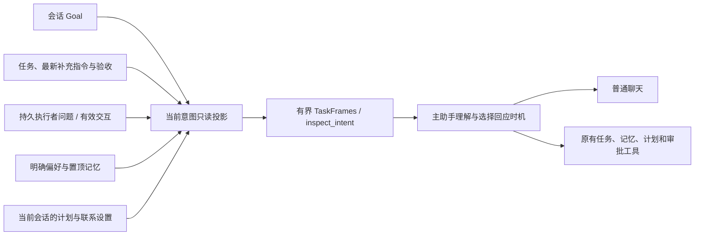

# 主助手当前意图视图

主助手在继续普通聊天的同时，需要知道当前会话承担了哪些目标、工作和待答复事项。`WorkerService::current_intent` 从现有权威记录生成只读投影，经 `TaskFrames` 在模型边界刷新；主助手也可以调用无参数工具 `inspect_intent` 立即查询。

[可编辑拓扑快照](design/peri-workbench/current-intent-20261026.html)新增当前意图来源与边界子图，保留旧画板及其本地存档身份。[提示词创作稿](prompt-review/PROMPTS-EDIT.md)同步主助手使用说明和装配位置，仍保留创作指引。

## 数据与来源

| 字段 | 来源与含义 |
| --- | --- |
| `goal` | 当前主会话 `cloud_goals`；带原 ID、状态、创建时间及语义版本。完成声明和验收证据分开。预算计费变化不改变这个语义版本。 |
| `active_tasks` | 当前主会话获准的持久任务；保留原任务 ID、revision、状态、唤醒与失效时间，以及最新补充指令的消息引用。运行、暂停、就绪、等待及取消中保持原状态。 |
| `recent_outcomes` | 已完成、失败、取消或失效的近期记录；保留产物/验证/主助手审查摘要。执行完成不自动生成验收通过结论。 |
| `pending_replies` | `waiting_parent` 任务的最新问题引用，以及原交互 Hub 中仍有效、归属当前会话或获准执行窗口的问题。已答复、失效或取消后退出。 |
| `preferences` | 账号明确保存的回复偏好及 revision；只在私人范围提供。 |
| `memory_references` | 当前有效的置顶 USER 条目预览，保留 ID、revision、原来源、事实/决定分类及期限；标为已记录记忆，不把它提升为用户新确认的事实。详情沿用 `GetMemory`。 |
| `scheduled_commitments` | 当前主会话明确登记的计划；保留计划 ID、revision、下次触发和通知能力，区分 scheduled、paused、finished；删除的计划由原目录排除。 |
| `contact_policy` | 私人范围的主动联系设置；实际发送仍由原调度、隐私和发件管道裁决。 |

长期事实继续归记忆系统，执行证据归任务和原操作账本。尚未登记的口头承诺留在对话中，由主助手理解，按用户授权使用已有目标、任务或计划工具登记。投影没有新的事实写入接口或人格存储。

## 范围、刷新与预算

- 作用域由宿主绑定的 OAuth principal、主会话和路由提供。工具参数为 `{}`，执行者不获得该工具，宿主也拒绝执行者作用域。私人偏好和记忆只进入私人视图，公共任务还需匹配原公共路由。
- 开始和提交前核对身份/设备、会话代次与记忆隐私 epoch，检查来源期限；期间发生遗忘、清空、回退或到期使本次编译失败。重启后重新从原账本读取。
- 不创建模型调用、执行器操作、聊天投递或任务。变化按现有 snapshot hash 更新，并沿用 `task_refresh_turns` 的对话轮次提醒；旧帧从模型视图退出，审计历史保留。审批专用控制回合不装配该视图。
- 审批的完整参数优先占用上下文预算，意图预览使用剩余空间。标准预览至多 12 KiB；工具另带观察时间。按类别报告 `omitted`，保留文字截断标记及详情工具；空间不足时明确返回 `available=false/context_budget`。
- 每次最多检查 16 项任务候选（受理上限为 8 项活跃任务），展示至多 8 项活跃任务、4 项近期结果、8 项待答复、6 项计划及4项置顶 USER 记忆。`task_scan.has_more` 和 `complete_history=false` 明确这不是完整历史。完整任务历史仍按原接口分页检索。

来源正文沿用原归属，作为待理解的数据；快照可用于定位，具体审批、继续执行、验收或修改仍走已有工具及代码校验。

## 行为样例与验收

| 场景 | 期望行为 | 验证方式 |
| --- | --- | --- |
| 派出任务后继续闲聊 | 主助手可以直接回应聊天，同时了解后台工作；普通进度不要求打断用户 | 模拟模型派活、执行者持久提问后，主会话仍能查询并完成另一轮聊天 |
| 执行者需要决定 | 主助手结合任务和已有事实回答；确实缺少用户决定时再提问 | 等待重启后查询问题，通过 `message_task` 回复，同一任务继续 |
| 工作完成 | 活跃事项退出，结果等待主助手核实和验收 | 验证近期结果为 completed，审查记录仍为空 |
| 用户取消或改要求 | 当前视图使用原状态与最新指令版本；取消中仍保持 cancel_requested | 验证控制取消经原协调器结算后退出活跃列表；补充消息保留原引用 |
| 遗忘、过期或切换受众 | 当前请求使用新授权视图，已失效的条目和旧工具结果遵守原记忆屏障 | 有期限条目、遗忘及重启、群聊隔离、伪造工具作用域的回归 |
| 报告、静默与主动问候 | 按当前用户话题判断是否报告；用户安排的问候和 when_useful 计划沿用原通知/静默能力 | 保留可编辑主助手指引及计划的 notify、notification、联系设置；发送语义沿用原渠道回归 |

本轮使用模拟模型与本地执行器验证逻辑；真实长对话中的语气、判断质量和报告时机，归 [#10](https://github.com/Teens-in-Times/peri-cloud/issues/10) 的真实模型/渠道验收。人格正文继续由用户创作。没有调用真实模型或升级生产。

### 本地验证记录（2026-10-26）

通过 `scripts/cargo-rmcp-patched.sh` 运行 Windows 验证：

- `test --locked -p peri-cloud --test gateway -- --test-threads=1`：94 项通过、0 失败、1 项既有子进程入口忽略，包含新增的四项当前意图联调，以及原审批、删除通知、换窗、故障恢复、渠道和调度回归。
- `test --locked -p peri-cloud --lib -- --test-threads=1`：135 项通过，包含序列化字节预算及省略标记回归。
- `clippy --locked -p peri-cloud --all-targets --no-deps -- -D warnings` 与 `fmt --all -- --check`：通过。
- 新联调覆盖来源与版本、跨会话/群聊/账号隔离、到期、遗忘与重启、12 轮连续聊天、持久提问与回复、执行结束和未验收的区别、取消后的退出及模型伪造作用域拒绝。
- 上游来源校验、源码/测试长度、可编辑提示词摘要与拓扑引用检查通过。没有修改 schema、依赖锁、上游补丁或原执行器实现；日志保留在忽略的 `target/`，不提交运行数据。

没有重复运行整个 Rust 工作区；GitHub CI 以关联 PR 的精确提交为准。拓扑完成结构检查，未声称浏览器视觉验收或真实模型行为验收。
