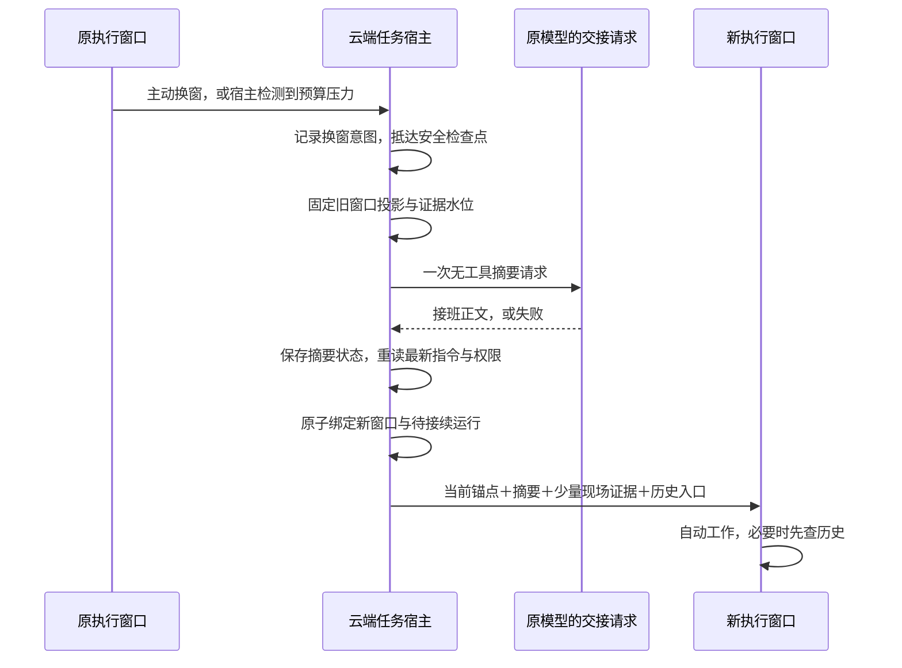

# 执行窗口轮换：任务锚点、接班摘要与历史查询

状态：设计基线，2026-10-24。本轮已将主要逻辑落到 schema 26；实际运行契约和保留边界见 [宿主实现](../worker-window-runtime.md)，验证见 [本轮记录](../worker-window-verification-20261024.md)。本文中的建议与示例不是额外已验证能力，Issue #7 保持开放。

## 1. 产品决定

主助手继续使用摘要式压缩。执行者使用硬窗口；同一逻辑执行会话、任务、设备和工作区保持原身份，替换的是模型可见的物理窗口。

一次正常换窗由三份材料接班：

1. 宿主生成当前任务锚点，准确呈现仍有效的要求与运行事实。
2. 原执行者的同一模型基于封存的可见上下文，生成简短接班摘要。
3. 新窗口通过目录、检索和稳定引用按需读取历史证据。

执行中因预算自动换窗，或执行者主动申请换窗，默认继续原已授权任务。用户手动切窗默认只交接并将新窗口准备就绪；仅在本范围存在明确授权、仍活跃的 goal 时自动续跑。普通任务尚未完成不等同于活跃 goal。任务本来在暂停、等待或核实未知操作时，继续保持原阻塞条件，不将换窗当成任务完成。

摘要采用独立的一次无工具模型请求，不让正常执行循环用普通 final 回复兼任交接。它不是新执行 agent，也不形成新的委派树。平时不要求执行者每几轮维护长记录。

## 2. 为什么采用独立请求

普通 assistant final 同时承担任务收尾与对话输出，不能可靠地以自然语言识别“这是交接，不是结束”。普通执行回合若仍有全套工具，也难保证模型及时停止工作并只整理材料。

专用请求明确具有以下边界：

- 使用该任务原模型配置和已授权可见上下文，模型在这里扮演原执行者的交接角色。
- 不启动普通工具链，工具列表为空；无论模型返回什么，都没有工具派发路径。
- 返回自然语言正文即可，宿主保存成带类型的 HandoffCapsule；不要求模型编写状态 JSON、ID、水位或安全决定。
- 请求不产生任务完成、验收通过、消息投送或执行权限。
- 每个换窗意图最多提交一次逻辑摘要请求；超时、输出不完整或不可用时直接降级，不反复要求续写。
- 计入现有账号模型额度，独立记录用途、输入输出用量、延迟和失败原因。额度不足时不绕过额度；可封存等待额度，已有合格接班材料则直接使用。

它依然需要一次 API 调用，通常还要读取旧窗口，因此有实际成本。保留稳定前缀可争取缓存，但不承诺缓存命中。先测成本与接续质量，不预设每次摘要一定划算。

执行者可以主动调用 request_window_rotation(reason, notes?)，其中 notes 是可选的短交接提示，不是强制长文。该工具仅记录宿主换窗意图。默认仍由专用请求整理摘要；若已有同检查点、同指令水位的完整合格 capsule，不重复生成。

## 3. 锚点与摘要分别写什么

### 当前任务锚点：宿主负责

- 当前任务目标、验收条件、全部仍有效约束和最新补充要求。
- 稳定任务 / 执行会话身份、当前窗口、原设备及规范工作区引用。
- 状态、暂停或等待原因、最新指令水位、尚未应用的消息。
- 未决操作引用、确认结果与未知结果的区别、当前资源占用。
- 当前产物位置及版本、验证结论和未验证项的有界目录。
- 交接摘要的来源、覆盖范围、生成时水位，以及生成之后发生的变化。

“精简”首先靠去掉重复和不相关字段，不靠截断必须遵守的要求。初版继续保留原始有效任务契约与补充指令；不假装代码能理解并删除已被自然语言取代的约束。若必需要求本身装不下，进入可解释的等待状态，请主助手协助收敛任务或提高窗口容量，不能循环换窗或静默丢要求。

### 接班摘要：模型负责

摘要重点传递工作理解：目前在解决哪个具体问题、关键发现、方案理由、已经排除的方向、尚未证实的假设、下一步建议，以及值得查看的证据引用。

宿主已经维护的状态和完整调用清单不要求模型抄写。摘要中的“已完成”“可执行”等表述只是模型判断，不能覆盖当前账本、权限、指令或验收。

初始建议输出上限为 1200 tokens、超时 30 秒，每次最多一个逻辑请求；这些是可配置试验默认值，后续按模型与中文材料质量校准。供应商不支持对应输出限制时采用其原生参数并保守预检；不能只在生成后截掉最后一半当作完整摘要。

摘要缺失、正文为空、工具形响应或输出因上限中断时，标记 unavailable / incomplete；保留诊断，不将残缺文本伪装为完整交接。新窗口使用宿主锚点、已有工作书签和历史目录继续。

不采集隐藏思考、provider 不透明块或内部推理轨迹。摘要表达可对外解释的工作理由和观察，并从授权可见消息构造输入。

## 4. 输入投影与预算

摘要请求输入由宿主编译：交接角色说明、完整当前任务契约、当前窗口的授权可见投影、候选证据引用目录。历史工具交换保持合法协议配对；不把未结算的 tool_call 冒充已有结果。

之前窗口的接班摘要可作为带来源的背景，但不累积复制全部旧摘要。原始历史仍然保留，后续可以绕过旧摘要查证。初版不在交接请求里增加第二套历史查询 agent；发现自己不知道时在摘要中标记缺口，由新执行窗口查询。

预算以实际将提交的请求为对象，计入系统、规则、技能、工具 schema、锚点、摘要、证据、消息协议和预留输出。不能只计算聊天正文，也不能将字节估算标记成精确 tokens。

定义 C=min(配置窗口, 模型窗口)，U=当前完整请求的保守用量，R=接班、输出与估算误差所需预留：

- 观察阈值：U 接近 C-R 时提前发一次带版本的预算提醒，普通工作仍可继续。
- 强制阈值：U 已达到 C-R，或预计下一次输出 / 工具结果会越界时，进入安全边界换窗。
- 绝对上限：每次模型提交前检查完整请求适配容量。超限时先做有来源的工具输出投影或换窗；必需契约仍过大则等待。

初版保持现有 48000 / 8000 的窗口 / 预留默认值，提醒可先放在 36000 左右、强制边界约 40000，实际值必须由完整请求估算和适配器校准得出。更小模型动态缩放；预留不足时跳过摘要，不能为了整理材料再撞一次硬上限。

大 Read / Shell 结果先持久保存，再给模型有界预览和引用；完整正文由历史详情读取。未确认操作结果不为“腾上下文”而丢弃。模型主动换窗和宿主阈值换窗共用同一状态机。

## 5. 正常时序



“抵达安全检查点”表示当前模型响应和原工具意图、已知回执均已落账，不表示所有后台进程必须结束。前台工具 future 不直接丢弃；后台已确认受理且可追踪的操作可以继续留在原窗口名下。

开始准备后旧窗口不再接受新一批副作用调用。主动换窗工具与普通写入工具同批出现时，宿主在整批派发前拒绝混合批次，不能先执行一部分再解释控制意图。已受理的旧工具按原身份继续结算。

新窗口不会自动重放旧工具，也不通过 inspect_task + update_task 两轮握手证明“已经看懂”。宿主将材料持久记为 presented；看过输入不等于理解或执行了要求。现有每次派发前指令水位与权限校验继续执行。

## 6. 持久状态机与并发

换窗有独立记录，不把所有阶段塞入 task.state：任务的 pause / wait / cancel 含义保持独立。

```text
Requested -> Frozen -> Summarizing -> Prepared -> Committed -> Ready
                           |              ^
                           +-> Fallback --+

Ready --当前允许续跑且运行条件满足--> Activated

任何提交前阶段 --取消/隐私失效--> Aborted
```

- Requested：保存原因、原窗口和请求 ID，重复请求返回同一意图。
- Frozen：保存原检查点与摘要输入投影身份；旧窗口停止推进，原工具可独立结算。
- Summarizing：先持久登记摘要请求用途和 attempt ID，再发一次请求；不持有数据库事务或全局控制锁等待模型，也不额外获取设备写锁。已有工具的设备占用按原账本保留。
- Prepared：保存完整或缺失摘要状态。重读当前任务、授权、隐私及消息，构造新锚点。
- Committed：同一事务更新逻辑执行会话的活跃窗口、任务绑定、续跑策略；仅在允许续跑时写入接续运行意图。唯一约束避免两次创建生效窗口。
- Ready：交接记录和新窗口已就绪。手动切窗无活跃 goal 时停在此处，不调用新窗口模型；宿主直接返回简短控制回执。
- Activated：调度器按运行意图去重受理新轮次。进程退出后可由记录继续，不靠模型重新提出请求。

只在新窗口身份分配和提交点使用短事务 / CAS，不跨 API 请求持锁。按逻辑执行会话确保一个写入中的模型窗口；其他会话和主助手聊天不受该换窗阻塞。

摘要期间到达新指令：摘要保留原 instruction_watermark，提交时将新增指令和“摘要生成后发生了什么”明确注入新锚点，不为每个消息重做摘要。摘要仍是旧水位下的工作理解；原始最新要求优先且完整呈现。

Ready 可能持续很久。首次真正激活前必须重新编译当前锚点、增量事件、权限与隐私检查，不能把准备时的状态当作最新事实；摘要原文及覆盖水位保留。goal 必须绑定当前授权执行范围，不能借账号其他会话的 goal 自动唤醒；在激活前已经暂停、取消、结束或失效的 goal 不授予续跑资格。

取消或隐私失效先于新工作激活。取消摘要请求是尽力行为；即使它随后返回，也不写入活跃接班上下文。旧内容不能借 summary 或索引绕过遗忘、清空、账号、设备、工作区或隐私边界。

## 7. 切窗后继续还是等待

| 当前情况 | 新窗口行为 |
| --- | --- |
| 正常工作中因预算换窗 | 自动入队继续，不等主助手或用户回复 |
| 执行者主动请求换窗 | 继续当前已授权执行，不以此扩大目标范围 |
| 用户手动切窗，无本范围活跃 goal | 只生成交接、准备新窗口，保持 Ready；不启动新工作模型请求 |
| 用户手动切窗，有本范围明确授权且活跃的 goal | 条件满足时自动推进该 goal，不能覆盖暂停、取消或其他等待 |
| 等待用户 / 主助手答复 | 保留问题与回复水位，不因摘要完成而唤醒；换窗通常延后到回复到达 |
| 主动暂停 | 保持暂停，接续材料可准备，只有显式恢复才激活 |
| 审批未决或设备离线 | 保留原阻塞；已具备的纯分析条件不自动扩大任务可执行范围 |
| 已确认在跑的原操作 | 可换窗并查历史 / 分析；原操作保留占用，冲突调用继续由公共资源层拒绝 |
| 原操作结果未知 | 可整理上下文、查询证据和核实原调用；阻止依赖该结果的继续执行、替代重放与完成结算 |
| 任务已结束、验收流程待主助手处理 | 不为填满旧窗口而再启动工作；无需换窗 |
| 空闲执行会话准备承接下一任务 | 下一任务入场时按需换窗；旧任务摘要仅作历史背景，不继承旧任务要求 |

主助手可见 rotating、摘要阶段、原调用状态、下一次可运行条件，但默认不向聊天渠道发送每次技术换窗通知。只有持续失败、必须用户处理的阻塞或正常任务进展需要通知。

## 8. 历史入口必须好用

复用 inspect_task 的授权和 detail 分段读取，不另造宽权限工具。新增的历史概览 / 检索视图属于本设计，当前尚未完整实现：

1. overview：当前锚点、最近窗口目录、该窗口主要工作、当前产物、待确认操作和少量关键引用；不默认全扫历史。
2. search：关键词 / 路径 / 工具名 / 状态 / 时间 / 窗口 / 消息方向等组合筛选，支持按原工具调用 ID 直接定位。
3. detail：按稳定 ID、内容版本和范围展开原文，明确 complete、truncated、has_more、扫描范围及保留边界。

每个命中返回简短片段、来源、任务 / 窗口 / 操作身份、时间或序号及详情引用。对词法搜索无结果只声称在已搜索范围无命中，不推断历史中没有。分页与检索不是反复把长日志塞进模型。

查询内容包括用户补充要求、可见工作说明、工具输入输出与产物验证；排除隐藏思考。任务 / 窗口摘要可以作为辅助索引，但命中后能直达原证据。初版不要求向量服务或额外付费搜索模型；执行者负责提出查询、选读和理解。以后有召回质量证据再决定语义索引，不把它作为换窗可用的前提。

启动包默认只有锚点、最近合格摘要、最近关键证据的有界预览及目录入口。摘要引用先核对可访问性与版本；引用失效时保留失效提示，不自动扩大检索范围。跨任务查询继续限制为显式复用执行会话的授权历史，任务历史不自动写入长期个人记忆。

## 9. 失败与重启

| 故障 | 处理 |
| --- | --- |
| 摘要超时 / 空响应 / 输出中断 | 标记不可用，仍准备宿主锚点和历史入口；按原续跑策略决定停在 Ready 还是激活，不无限摘要重试 |
| 摘要请求已提交但进程退出，结果未知 | 如 provider 可查询则查询；否则不自动再提交同一摘要请求，进入 fallback。费用与用量标未知，不能记成零 |
| 输入超限或模型拒绝摘要 | 缩减可选投影或直接 fallback；完整要求仍装不下则等待，不循环 rotate |
| 摘要或检查点持久化失败 | 不提交新窗口，持久状态恢复后再决定；不能只靠内存把材料传走 |
| 提交前崩溃 | 从换窗记录恢复；已分配但未生效窗口不能开始执行 |
| 提交后、入队前崩溃 | 从同一持久接续意图去重入队，不能生成另一个并行窗口 |
| 用户取消 / 遗忘与摘要返回竞争 | 重新校验后丢弃过期摘要，取消与隐私失效优先 |
| 新窗口启动即再次超限且无工作进展 | 记录容量不足并等待主助手处理，不反复生成摘要和窗口 |

普通暂停 / 外部等待仍释放推理槽位；摘要请求占用现有账号模型并发额度。换窗期间不得双开旧 / 新工作请求。原运行中工具的资源占用不因为窗口封存或模型槽位释放而解除。

## 10. Rust 宿主接缝（伪代码）

```rust
struct RotationIntent {
    id: RotationId,
    execution_session: ExecutionSessionId,
    task: TaskId,
    source_window: WindowId,
    checkpoint: CheckpointId,
    instruction_watermark: i64,
    privacy_generation: PrivacyGeneration,
    resume_policy: ResumePolicy, // ContinueAuthorizedWork / ManualRequiresActiveGoal
    phase: RotationPhase,
    destination_window: Option<WindowId>,
}

struct HandoffCapsule {
    rotation: RotationId,
    source_checkpoint: CheckpointId,
    instruction_watermark: i64,
    status: HandoffStatus, // Complete / Unavailable / Incomplete
    body: Option<String>, // 模型写正文；身份、版本与用量由宿主填写
    evidence_manifest: EvidenceManifestId,
    model_attempt: Option<ModelAttemptId>,
}

async fn freeze_rotation(scope: &TaskScope, cause: RotationCause) -> Result<RotationIntent>;
async fn generate_handoff(intent: &RotationIntent, cancel: CancellationToken)
    -> Result<HandoffCapsule>;
async fn compile_resume_bundle(intent: &RotationIntent, capsule: &HandoffCapsule)
    -> Result<ResumeBundle>;
async fn commit_rotation(intent: &RotationIntent, bundle: ResumeBundle)
    -> Result<DurableContinuationIntent>;
```

此处类型为设计表达，不能直接冒充现有 API。目标是将换窗控制、摘要生成、材料编译、事务提交和接续调度拆开，继续复用原权限、账号模型出口、操作账本与调度器。

## 11. 对现有代码的落点

| 现有模块 | 现有能力 | 计划适配 |
| --- | --- | --- |
| tasks/middleware.rs | 模型边界、检查点、完整活跃约束帧 | 完整请求预算观测、单次预算提醒、启动材料呈现 |
| tasks/suspension.rs | 安全边界停止、rotate_requested | 主动与自动触发归一，停止原因类型化 |
| tasks/recovery.rs | 原操作核实、fresh_worker_window、commit_continuation | 拆出持久 RotationCoordinator，原子提交与自动接续 |
| tasks/continuity.rs | 检查点、调用意图与原回执 | 作为冻结证据来源，继续保持原始调用归属 |
| tasks/evidence.rs / history.rs | 授权历史、版本化分段详情 | 更便捷的概览、组合检索、稳定引用目录 |
| peri-agent compact_v2/full.rs | 已有无工具摘要请求的能力边界 | 借用请求构造与可见消息转换，不直接复用摘要续写循环和旧投影写回 |
| 账号模型出口、额度与 trace | 既有调用配置、额度和观测 | 标注 handoff_summary 用途，记录未知摘要调用结果 |

采用独立模块 windows/{budget,coordinator,handoff,history,store}，具体文件按仓库规范控制在 1000 行以下。本轮在 schema 25 后新增迁移 26，不重置运行数据库。

## 12. 实施与克制验证

1. 换窗意图与原子接续：先落持久状态和唯一约束，复用原操作恢复；不先改提示词假装流程已经存在。
2. 无工具接班请求与启动包：同模型、一次请求、限额、失败兜底、最新要求增量；更新执行者与交接提示词。
3. 概览与检索：复用 detail 和原权限，补目录与组合筛选，再做预算提醒和主动换窗工具。
4. 集成模拟：低窗口下至少连续三次换窗，覆盖成功摘要、摘要不可用、摘要期间补充 / 取消、提交前后崩溃、旧工具继续运行与未知结果、重复入队、隐私失效及空转换窗。

测试集中覆盖以上状态、安全与恢复，不对 Markdown 文案或内部字段逐项镜像测试。按 README 对变更 crate 执行针对性测试、fmt、Clippy，使用 rmcp 补丁脚本；不需要真实模型密钥完成工程联调。

真实模型阶段另行授权，比较接续正确率、检索次数、重复阅读量、上下文输入量、摘要额外费用和延迟。模拟测试只能证明机制边界，不能证明模型能从摘要正确接班。

验收重点：自动换窗不要求人工“继续”，手动切窗无活跃 goal 时确实不续跑；执行者无需日常长篇维护；摘要丢失仍可恢复；新窗口能查到原证据；最新要求始终生效；副作用和送达不因换窗重放。主助手仍可自然聊天、查看执行者进度和插话。

## 13. 提示词意图草稿

以下保留设计参考正文；运行时提示词位于 peri-cloud/prompts/window-handoff.md 与 window-resume.md，并同步到提示词创作包。具体身份、事实与历史内容由宿主用带来源的帧装配。

接班请求：

> 为同一执行者的下一个窗口写一份简短接班说明。重点保留正在解决的问题、关键发现、重要取舍、失败尝试、尚待验证的假设，以及建议的下一步。为关键结论附上输入材料中可用的证据引用；分清观察、推断和未知。优先帮助接班者继续当前工作，宿主已有的任务状态和调用清单可以省略。材料不足时写清缺口。

新窗口续接：

> 你继续执行当前任务。当前锚点提供最新要求与运行事实，接班说明传递旧窗口的工作理解，历史入口用于核查和找回细节。先判断当前材料是否足够；足够就继续，存在具体缺口再查相应历史。依照当前有效要求工作，将摘要后的新增指令纳入下一步计划。遇到需要外部条件的问题，使用任务等待与沟通能力表达具体卡点。

提示词负责工作策略；工具能力切断、输入预算、权限、指令水位、等待、取消、原操作结算与窗口唯一性仍由宿主代码保证。

## 14. 交接包与实际示例

交接记录是一个有版本的容器，内容分开存储并标记来源，不把模型正文升级为系统指令：

| 部分 | 生成者 | 刷新时机 |
| --- | --- | --- |
| Anchor：当前任务契约与状态 | 宿主 | 准备时生成，实际激活前重建 |
| Capsule：工作理解与建议 | 同一模型的专用无工具请求 | 针对封存检查点生成一次，保留原覆盖水位 |
| EvidenceManifest：证据目录 | 宿主 | 引用源记录和版本，读取时再次授权 |
| Delta：摘要之后的变更 | 宿主 | 实际激活时由指令和事件水位确定 |
| ResumePolicy：续跑资格与阻塞原因 | 宿主 | 用户控制时记录，激活时重核 goal 与现有状态 |

给新模型看的内容例如：

```text
[当前事实 / 宿主]
任务：修复 OAuth 登录失效；保持现有人工同意流程。
状态：补丁已生成，回归未完成。
操作 op-42：测试已受理，尚未取得最终结果；产物版本见 artifact-7。
最新补充要求：同时验证退出后重新登录。

[上个窗口的工作理解 / 模型，覆盖至指令 18]
目前怀疑刷新后的 cookie 属性不一致，已有复现记录 ref-A。
只改回调路由的尝试没有解决问题，证据 ref-B。
下一步建议先查看 op-42 的原结果，再核查 cookie 设置。
这仍是假设，尚未确认根因。

[摘要之后的变化 / 宿主]
指令 19 新增退出重登要求。
op-42 在摘要后结束：一项回归失败，原结果见 ref-C。

[历史入口 / 宿主]
ref-A：复现记录；ref-B：上次修改与结果；ref-C：测试失败详情。
可以按当前任务、路径、窗口、工具名与调用 ID 检索并分段展开。
```

上述 ID 仅为示例。真实 ID 与版本由宿主提供，模型只能引用已提供或已读取的来源；未解析引用明确标为不可验证，不拿它满足验收。

手动切窗无 goal 的 Ready 阶段只保存这些组成材料和引用，不为“读完交接”额外启动一次模型请求。用户下一条普通问题也不自动授权恢复旧工作；宿主沿现有聊天 / 任务路由处理输入，只有明确继续原任务或获准的活跃 goal 才启动旧任务。自动预算换窗则在激活检查通过后直接提交首个工作请求。

连续手动切窗而中间没有新模型工作、指令或可见事实变化时，复用同来源检查点的合格摘要，避免对摘要再摘要。每个旧包保留来源，后续包只携带最近合格正文及必要引用，不滚雪球式拼接所有旧包。
