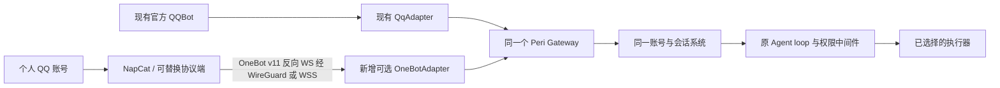

> 2026-10-17 实施更新：可选 OneBot v11 适配器、文字菜单引用和双入口集成测试已落地。本文保留原调研过程；当前实现、限制和配置以 [个人 QQ 接入](onebot.md) 为准，真实 QQ 登录需另行验收。

# QQ 菜单与个人账号网关设计

调研日期：2026-10-16。使用范围：个人自用，不进行商业分发。本轮实现现有 QQ 菜单优化；个人账号网关为接入方案，未安装协议端、登录账号或切换线上渠道。

## 已确认的产品边界

- QQ 是主要会话窗口。常用操作、审批、逐题回答和结果阅读在聊天中完成。
- 保留官方 QQBot 作为现有网关适配器。个人账号方案增加独立可选适配器，允许并存，不是全面替换。
- Peri 仍只运行一套账号、会话、Agent loop、任务日志和权限中间件。NapCat 等协议端负责 QQ 收发。
- 现有 QQBot 配置、身份与会话不迁移。新增账号重新关联到 Peri 账号，执行设备继续复用该账号的设备池。

## 官方 QQ 与 Hermes 对照

[QQ 官方按钮文档](https://bot.q.qq.com/wiki/develop/api-v2/server-inter/message/trans/msg-btn.html)允许自定义键盘最多五行、每行五个按钮；自定义按钮需具备对应开通权限。文档未给出当前代码采用的“标签 20 字符”限制，也没有保证任意长度文字能在所有客户端完整显示。

官方协议将链接、回调、输入框指令分别定义为 action.type 0、1、2；回调产生 INTERACTION_CREATE，需调用回应接口结束客户端 loading。visited_label 是点击后的显示文案，不能代表后台已完成授权。接口层面的允许点击，也不能替代后台的归属验证。

[Hermes 键盘实现](https://github.com/NousResearch/hermes-agent/blob/275b15fc35193b8ddafcf16776539c04587e6ccf/gateway/platforms/qqbot/keyboards.py)使用简短的动作按钮、独立回调数据与点击后文案，审批正文明确命令、目录和超时。这些设计适合吸收，但源码注释中 type=2 的含义及 click_limit 的依赖不能直接照搬：以官方协议为准，click_limit 已弃用，服务端仍必须保证单次消费。

Peri 保留已有精确账号、聊天、请求、会话及提问版本校验。未知投递不自动重发；客户端按钮外观不成为权限事实。

## 本轮已实现的菜单体验

1. 去掉按钮标签强制截取 20 字符、正文静默截取 1800 字符的做法。
2. 普通菜单采用两列；少量长名称采用一列，超过十项采用三列，最多五行。标签宽度预算是保守的产品策略，不是腾讯规定或跨客户端像素保证。
3. 短标签显示“编号 · 动作”；长标签显示“选 编号”，完整名称放在对应的 `/选 编号 · 完整名称` 正文中。不同名称即使前缀相同也不会变成相同省略文本。
4. 点击后保留原按钮标签，后台通过新消息确认结果，避免显示笼统的“已选择”。
5. 原生键盘与纯文字回退使用同一份完整选项文字。按钮不可用时，QQ 内的指令仍可完成操作。
6. 超长菜单以每页 1200 个 Unicode 字符分页，并明确显示页数和下一页命令。`/菜单详情` 查看本聊天最新菜单；`/菜单详情 页码` 快速翻页；正文提供的 `/菜单详情 快照ID 页码` 固定原菜单，避免中途被新菜单替换。
7. 阅读详情只查询已有持久发件记录，不调用模型、不提交答案、不消费或延长按钮。读取绑定原账号、适配器、用户和聊天；详情提供 `/选 快照ID 编号` 操作原菜单，避免误操作新菜单；过期操作仍需重新打开菜单。
8. 提问题目、设备、工作区、当前页选项名称与说明保留全文。正文“答案 n”表示 `/回答 n` 的题目编号；`/选 n` 则明确操作最新菜单中的第 n 个按钮。
9. 设备列表补齐上一页。历史工作区显示完整路径并前后分页，避免同名末级目录混淆与历史选项被静默丢弃。
10. 菜单生成超过内部十五项容量时报错，调用方必须显式分页，不再默默丢掉尾部按钮。

最极端的长名称可能跨文字页，所有字符仍保留，可继续阅读。审批工具摘要仍按既有安全展示策略保留限长预览，完整参数走 `/详情`；它不属于目录/问题选项的名称截断。

## 个人账号方案调查

| 项目 | 所处层次与现状 | 对 Peri 的用途 |
| --- | --- | --- |
| [NapCatQQ](https://github.com/NapNeko/NapCatQQ) | 基于 NTQQ 的协议端；支持 OneBot 11 网络通信 | 自用场景优先验证，通过独立 OneBot 适配器连接 |
| [AstrBot](https://github.com/AstrBotDevs/AstrBot/blob/de898afe7588e1f153beec06e24f03f6ddeae2e4/docs/zh/platform/aiocqhttp.md) | 上层应用框架；其 OneBot v11 反向 WebSocket 可连接 NapCat | 借鉴平台管理、引用回复及插件交互。Peri 已有 Agent，接入不需要再运行一套 AstrBot 推理系统 |
| [LLBot / LuckyLilliaBot](https://luckylillia.com/guide/introduction) | 原 LLOneBot 路线的现行项目；文档提供 NTQQ 客户端桥接与纯协议模式，支持 OneBot 11、Milky、Satori | OneBot 适配器的第二个候选协议端；功能差异应实测，不能默认完全兼容 NapCat 扩展 |
| [Lagrange.Core](https://github.com/LagrangeDev/Lagrange.Core) | 当前主分支为 V2，V1 已结束维护；文档面向 .NET/NativeAPI，并提供 Milky 服务方向 | 作为未来协议替代候选；不能套用旧 V1 OneBot 安装指南当成当前路线 |
| [NoneBot2](https://github.com/nonebot/nonebot2) | Python 应用框架，有独立 OneBot 适配器 | 交互与插件生态参考，不能单独替代 QQ 登录协议端 |

[NapCat 消息兼容表](https://doc.napneko.icu/develop/msg)列出文字、图片、语音、视频、引用、合并转发及文件；其中 Markdown 发送注明需处于双层合并转发中，无法直接发送。JSON / 小程序卡片存在不等于获得官方 QQBot 自定义键盘及回调权限。因此，个人账号版不依赖弹出卡片、可点击键盘或伪装的图片按钮。

[NapCat 网络文档](https://doc.napneko.icu/onebot/network)描述 HTTP 和 WebSocket 多种角色；实现时应对照具体协议端实测握手、Token、事件、echo 和结果字段，不只依赖示例文字。推荐反向 WebSocket：NapCat 主动连 Peri，收发走同一受认证连接。已有 WireGuard 可以承载这条线路。

按 [OneBot v11 反向 WebSocket 标准](https://github.com/botuniverse/onebot-11/blob/master/communication/ws-reverse.md)，单连接同时收事件、调用 API 应采用 Universal 角色，并校验 X-Self-ID 与 X-Client-Role；API / Event 分离模式是两条连接。[鉴权标准](https://github.com/botuniverse/onebot-11/blob/master/communication/authorization.md)使用 Authorization: Bearer 请求头。Peri 接入应要求 Token，并避免将其放入可能被代理记录的 URL 查询参数。

自用优先评估 NapCat。保留它作为外部独立服务，不把协议端源码混入 Peri。当前 [NapCat LICENSE](https://github.com/NapNeko/NapCatQQ/blob/810052c605feb5044a080adfe99ba2fa69b7b351/LICENSE)含非商业限制；本次无商业分发需求，不把商业打包作为本轮前提。LLBot 当前仓库采用 GPLv2，选择具体版本及分发方式时保留其许可证和第三方声明。

## 附加适配器拓扑



官方 QQBot 原有 WebSocket / Webhook、令牌、回调和持久发件策略保留。新增 OneBot 的协议配置独立，不覆盖 `qq` 配置；两个适配器 instance_id 必须不同。

OneBotAdapter 只负责事件归一化、消息发送与协议能力呈现。官方 OpenID 与 QQ UIN 均作为各自命名空间的不透明外部身份，不能自动互转；同一个人可显式关联两种渠道到自己的 Peri 账号，聊天选择仍相互独立。

每次连接核对预期 self_id，拒绝错误账号。群内按 @机器人、明确命令或引用机器人菜单触发；忽略机器人自己的消息，避免回声循环。默认不把无关群聊或私人会话输入模型。重连不回放未知发送结果，API echo 只关联响应，不视为远端去重保证。

管理界面只走本机 / 私网访问。使用独立 QQ 账号承载机器人，保存登录态与协议 Token 的目录受权限保护。NapCat 的[安全文档](https://doc.napneko.icu/other/security)明确讨论账号风控、掉线与接口认证；实际验证包含这些运维情形，不承诺账号永不受限。

## 无按钮时的交互设计（后续适配器实现）

```text
选择执行设备 · 菜单 M7
1 东京服务器：生产环境
2 北京服务器：日常开发
3 家里的 Windows：代码工作区

引用这条消息回复 2，或发送 /选 M7 2。
```

- 普通菜单：完整名称、稳定编号、简短菜单码。引用消息 ID 和菜单码都解析到同一份持久快照，再走已有动作令牌，不按标签猜动作。
- 未引用的 `/选 2` 延续现有“当前最新菜单”语义；`/选 M7 2` 是新增方案，当前版本尚未实现。群聊有多个有效菜单时不猜测对象。
- 多选：引用题目回复 `1,3` 仅更新草稿，显示已选完整名称，再明确提交；文字答案走已有 `/回答`。
- 审批：正文列出设备、目录、操作及有效期，使用已有 `/允许 短码`、`/拒绝 短码`、`/详情 短码`；“好的”“继续”不隐式放行权限。
- 进度：一条简短状态，阶段变化或需要介入时更新，避免把工具日志刷满群聊。是否能更新原消息需按协议端能力决定。
- 长结果：先给结论，QQ 内分页；协议端支持时补发报告文件或合并转发。文件 / 合并转发是阅读方式，不承担授权。
- 平台消息 ID 与菜单快照的映射需持久化，重启后可查询；只在发送成功得到 message_id 后记录。发送结果未知不得为了得到 ID 自动重发。

## 验证与落地顺序

本轮覆盖长中文同前缀、Unicode 全文分页、Markdown 转义、纯文字回退、旧快照分页、同账号不同群及不同用户隔离、读取不调用模型且不消费回答、同名历史工作区完整分页，以及既有投递不确定性与权限回归。

新增适配器后先在隔离的 OneBot 测试端验证：并存配置、身份独立、预期 QQ self_id、Token、引用、群聊触发、重复事件、掉线、超时、echo、未知发送不重试与关闭排空。真实 QQ 登录及群聊呈现另做账号验收；测试端不能替代真实手机 / 桌面 QQ 的显示证据。

调研快照：NapCat `810052c605feb5044a080adfe99ba2fa69b7b351`；AstrBot `de898afe7588e1f153beec06e24f03f6ddeae2e4`；LLBot `dc2b2b90092ef0f571b5546878288b83fff1e436`；Lagrange.Core `20c2ba079b5ee67156bd71419ed54ea61a24e91f`；Hermes `275b15fc35193b8ddafcf16776539c04587e6ccf`。
