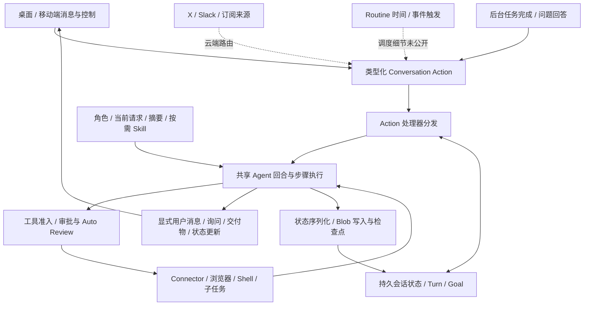

# Grok Bot 个人 Agent 整体设计调研

调研日期：2026-10-18。研究对象限定为 Grok Bot；Grok Build 的记忆实现不作为 Bot 的实现证据。本文描述公开产品行为、早期运行时代码与对 Peri 的设计建议，没有改动生产实现。

核心结论：Grok Bot 把长期角色、持久会话状态、不同来源的动作、按次运行、显式通信和持久工作环境组织在一起。最值得借鉴的是这些对象的衔接方式，以及等待、续跑、交接和恢复时保留的身份与状态。

## 1. 证据范围

- **D：官方文档。** 本次核对概览、Bot 管理、聊天协作、电脑与应用、文件、移动端、X 入口、Skill/Routine、通知、审批、Team Bot、安全、电脑管理、私网、故障恢复和 FAQ 共 16 个页面。页面日期主要为 2026-09 至 2026-10；功能可能分批开放。
- **S：运行时档案。** 读取 Grok Bot 0.18.0 安装包运行时拆分档案，固定到 `bd06ef2cab1becec4b78d5237790a6783737460b`。它是第三方整理的可读 bundle 档案，不是官方授权开源工程。本次没有独立重做官方安装包哈希链验证。[档案来源][archive]
- **I：架构解释。** 下文的逻辑分层与关系图由 D/S 证据推导，不代表还原了官方服务部署拓扑或数据库表。
- **U：未确认。** 云端调度、长期记忆后台、跨端竞争、外部动作幂等和最终投送协议没有完整公开实现证据。

运行时含有 IDE、CLI、云端与 Bot 共用代码，许多路径受配置和 feature flag 控制。“模块存在”只证明该能力进入了归档代码，不能据此判断所有当前 Bot 都启用了它。档案未授予代码复用权，本研究只提炼机制。[来源验证说明][verification]

## 2. 产品的组织中心是长期角色

**D。** 官方将 Bot 描述为有名字、职责、自己的对话和逐渐积累的工作上下文的长期伙伴。常驻描述承载稳定职责与边界，消息承载具体任务。隐藏不等于暂停；复制可带配置与 routines，但不复制历史、学到的记忆和附件。[Bot 管理][bots]

这支持“配置、积累状态和运行生命周期分开管理”的解释。它的公开交互以每个 Bot 的持续对话为中心；不能进一步假定它提供任意数量、相互独立、可以随意切换的私人 session。

**D。** 桌面和移动端访问同一套 Bot、会话与云端工作；关闭客户端不会结束后台工作。[移动端][mobile]

**I。** 因此，窗口、网络连接和进程生命周期不应定义助手的生命周期。用户感受到的连续性来自身份、状态与环境的保留，不需要模型持续生成。

## 3. 核心对象及归属

以下是逻辑对象模型，其中名称部分来自源码，关系是本次整理。

| 对象 | 承载内容 | 与其他对象的关系 | 证据 |
| --- | --- | --- | --- |
| Account / 实际用户 | 资源归属、登录与访问范围 | 拥有个人 Bot 和云电脑；跨端登录同一账号 | D |
| Bot / 角色 | 名字、职责、风格、稳定规则 | 关联自己的交流与积累状态 | D |
| Conversation | 持久历史、当前模式与工作上下文 | 接收不同 Action，包含多个回合 | S |
| Action | 一次待处理输入或控制动作 | 消息、通知、恢复、问题回答、后台完成等有不同处理器 | S |
| Turn / Step | 一次执行及其模型与工具步骤 | 在既有会话状态上运行、留下结果 | S |
| Goal | 跨回合目标与续跑状态 | 关联会话/Agent session；区别于时间计划 | S，启用情况未确认 |
| Background work | Shell、子任务等运行记录与完成信息 | 完成后可以回到父级处理流程 | S |
| Learned context / notes | 长期偏好、工作事实、笔记 | 产品承诺与文件笔记路径可见，完整后台算法未知 | D/S/U |
| Skill / Routine | 方法与触发配置 | 前者描述如何做，后者安排何时做、由谁做 | D |
| Computer / Connector | 文件、浏览器、执行工具与服务访问 | 个人 Bot 共享账号的电脑与插件；本地执行另有授权 | D |
| Interaction / Message / Artifact | 状态更新、询问、用户可见消息、交付物 | 执行可以产生多种输出，不必都变成聊天文本 | D/S |
| Checkpoint / Blob | 可重建的会话状态与内容引用 | 支撑持久化、恢复和按需取回内容 | S |

对象关系依据：[运行时入口][runtime]、[状态结构][state]、[状态存储][store]、[官方概览][overview]。

## 4. 逻辑架构

实线表示有公开行为或代码支持的逻辑关系；虚线表示根据产品行为归纳的云端接入/调度关系。这里不规定这些模块实际部署在哪个进程。

**S。** `AnysphereAgent` 构造处理器映射，`runStream` 根据 action 类型选择处理器；处理完一个 action 后，还会消费会话接收器里的后续 action。[分发与队列][runtime-dispatch]

**I。** “事件与对话分离”更精确的含义是：输入原因与会话状态分开建模，再由明确的 action 驱动状态上的执行。已读代码呈现的是 action 分发与检查点机制，尚不能认定其完整后端采用事件溯源架构。

## 5. 一次工作如何开始、等待与继续

### 5.1 多种输入，共用执行基础

**S。** 处理器映射包括以下类型。注册本身不证明某项功能对当前产品开放。[处理器映射][runtime-actions]

| Action | 已读路径中的作用 |
| --- | --- |
| `userMessageAction` | 普通消息与新指令 |
| `subscriptionNotificationAction` | 订阅通知适配成系统唤醒输入 |
| `goalContinuationAction` | 对已有目标继续推进 |
| `resumeAction` | 恢复已有会话与待处理工具步骤 |
| `asyncAskQuestionCompletionAction` | 处理此前异步问题的回答 |
| `backgroundTaskCompletionAction` | 记录子任务完成，决定是否启动后续处理 |
| `cancelAction` | 取消控制入口 |
| `summarizeAction` | 主动摘要入口 |
| `executePlanAction` | 执行计划入口 |

**S。** 订阅通知复用普通消息处理器，但携带 `isSyntheticWakeup`；普通处理器据此避免将系统唤醒当作用户新消息而恢复暂停的 goal。[通知适配][notification-action]、[来源语义][synthetic]

**S。** 唤醒合并函数按会话与事件 ID 去重，按 `conversationId + groupKey` 替换同组待处理唤醒。已读的本地队列是内存实现；宿主还有后台任务监视与完成回调，不能把整个系统的持久性简化为这个内存队列。[合并][wakeup]、[本地队列][background-registry]、[宿主后台工作][host-background]

### 5.2 用户可以在执行期间改变方向

**D。** 官方说明，用户直接发来的消息优先于后台工作，可以改变当前回合方向；停止指令结束后续工作，但不撤销已经产生的外部效果。[聊天协作][chat]

**S。** 回合循环会查看排队动作，并有在执行中消费新用户消息、创建新回合以及注入异步问题回答的路径。[回合中的新输入][queued-input]

**I。** 这要求运行、输入队列和界面连接分别有生命周期。用户发送一条新消息无需等待整项后台工作完成；取消、改方向与撤销外部操作也需要分别定义。

### 5.3 Goal 与 Routine 是两类持续性

**S。** Goal continuation 校验目标的会话与 Agent session 归属，记录续跑计数，并会在连续续跑却没有工具活动时暂停以防空转。它通过带来源标记的合成消息复用普通处理器。[目标续跑][goal]

**D。** Routine 安排时间或事件触发工作流，与具体 Skill 方法分开；文档中的测试运行会真的执行任务。[Skill 与 Routine][routines]

**I。** Goal 表达一个目标尚未完成，Routine 表达未来什么时候再发起工作。我们不应只用 cron 重复执行同一提示词来混合表达二者。

### 5.4 等待人类回答可以结束当前执行

**S。** 已读宿主会把问题 widget、secret request、电脑接管交给独立交互路径；等待用户选择后继续发送会被阻止。问题完成还关联原 tool-call 身份，状态中保存去重收据。[用户消息工具][send-message]、[等待门控][awaiting-user]、[回答去重][question-receipt]

**I。** “助手还在等你”可以是一种持久状态，无需让模型请求一直挂着。回答到达后驱动后续处理，同时保留原问题与原任务的关系。

## 6. 执行与用户通信进一步分层

这是本次比前一轮调研更重要的新发现。

**S。** 0.18 宿主提供显式 `SendMessage` 工具；该工具描述与提醒中间件约定普通 assistant 文本不直接成为用户可见回复。工具实现构建消息并交给宿主回调，宿主发出 `send-message` 更新，可能返回消息 ID。[工具与出口][send-message]、[宿主投送回调][host-send]

**S。** 这条宿主工具装配路径只为非 subagent runner 装入该消息工具。子任务可以返回结果，父级继续判断如何对用户汇报。已有部分平台通信工具也对子代理排除。[消息能力装配][host-send]、[平台通信工具][platform-tools]

**I。** 这提供了显式管理交流节奏的基础：一轮可以发简短进展、发交付结果、请求输入，也可以不发消息。它并不证明完整投送链有持久 outbox 或外部平台 exactly-once 保证。

**S。** 宿主还提供单独的异步 Bot 间消息能力；唤醒提示区分助手来信与真实用户指令，并允许无须行动的通知保持静默。群聊语境提示也区分当前私人 DM 与其他参与者可见的内容。[Bot 间消息与来源][agent-messaging]

这些提示约定不能单独证明访问控制有效。将来在 Peri 中吸收这一思想时，实际收件人、账号归属、授权和上下文代次仍由宿主与 MessageAdapter 核验。

## 7. 连续性来自不同层的状态

| 层次 | 能确认的机制 | 不应混同的概念 |
| --- | --- | --- |
| 角色与稳定偏好 | 官方描述长期角色与学到的上下文 | 完整历史的逐字回放 |
| 活跃会话上下文 | 回合、消息、当前工具步骤与摘要 | 独立于会话的全部长期事实 |
| 工作笔记 | shared / conversation notes 路径与配置可见 | 路径本身授予跨账号访问权 |
| Skill 方法 | 目录发现、按需使用、正文保留策略 | 个人事实或工具授权 |
| 工作环境 | 文件、浏览器登录与应用状态持久 | 模型能够自动理解所有磁盘内容 |

**D。** Bot 可以保留偏好、工作事实与摘要；变化中的事实仍应回到当前权威来源核验。[官方记忆说明][bots]

**S。** 摘要实现区分 system、user info、最近用户输入和摘要；摘要带 `isSummary` 标记，并有单独的 Skill 块与耐久内容保留步骤。运行时可以选择不同模型对应的 compaction handler；后台摘要是否启用由配置决定。[摘要流水线][summary]、[摘要调度][summary-orchestrator]、[模型适配][runtime]

**S。** Skill 目录会按模型窗口估算预算，先缩短描述，再退化到路径，最后省略部分条目并提示；已读实现的初始目录预算为 2%。[Skill 预算][skill-budget]

**S。** Notes 配置区分共享笔记目录和当前会话笔记目录。[笔记上下文][notes]

**U。** Bot 长期事实记忆的完整 schema、自动提取时机、冲突合并、删除传播、向量检索与跨 Bot 授权细节尚未确认。不能把摘要、笔记路径或 Build 的 capture/dream 当成这些问题的答案。

## 8. 持久化与恢复

**S。** `AgentStore` 保存会话结构与根 Blob 引用，并能从元数据中的根引用重建状态。运行时在状态更新回调前调用 BlobStore flush，出错时也尝试排空挂起写入。[AgentStore][store]、[检查点顺序][runtime-checkpoint]

**S。** `resumeAction` 重新取得当前请求上下文与工具集合。恢复待处理工具时，已有 contract 包含原工具名称、标识和准入工具范围，恢复阶段会检查工具身份是否匹配。[恢复路径][resume]、[工具 contract][tool-contract]

**I。** 值得借鉴的是“恢复有专用入口、依赖有身份、状态发布有顺序”。检查点不是外部动作已执行或未执行的充分证据；仍需单独追踪执行和投送结果。

**D。** 官方把电脑 recreate、terminate 和删除 durable data 分开；recreate 尝试安全点暂停并迁移，无法暂停时可失败；terminate 结束当前运行但保留耐久盘，下次访问可启动新电脑，运行中的回合可能丢失。[电脑生命周期][computers]

**D。** 故障排查先处理客户端重连、恢复与更新，最后才重置；离线界面不证明云端已停工。[故障恢复][troubleshooting]

**U。** 未确认官方端到端是否能在所有断电、网络超时或第三方 API 不明确响应下避免重复副作用。Peri 的未知执行/投送不重放原则应继续保留。

## 9. 资源、凭据与审批

**D。** 个人账号下的 Bot 共享云电脑、文件与浏览器登录，但各有屏幕；屏幕是工作表面，不是安全隔离。Connector 优先提供结构化操作，浏览器补足未覆盖流程，本地电脑执行是单独能力。[电脑与应用][computer]

**D。** Auto Review 使用独立模型评估部分工具/电脑动作，支持允许、询问和拒绝。官方也说明它不覆盖所有副作用，例如记忆写入和大部分设置；Connector 策略与网络出口策略是分开的控制层。OAuth token 由后端保管，调用工具无需把 token 交给模型。[安全架构][security]

**D。** 等待审批的动作有明确目标与参数；后台触发的审批约十分钟失效，之后新增规则不会补执行过期动作。密码、验证码等使用接管或安全输入路径。[审批交互][approvals]

**I。** 对 Peri 的适配重点是分清身份、访问与执行许可：可使用某 Connector、可访问某设备、允许执行某次动作是不同判断。现有原权限中间件继续作为审批权威，不引入另一套模型裁判覆盖它。

## 10. 交付、注意力与长期使用

**D。** 文档鼓励返回可检查、可修改和可继续反馈的交付物；文件、链接与结果在对话中关联展示，云端编码任务的结果也会带回 Bot 的交流中。[文件与交付][files]

**D。** 工作中、等待问题/审批/接管、新结果未读是不同注意力状态；系统通知主要面向完成或需要输入，应用聚焦时通常抑制通知。[通知设计][notifications]

**D。** X 的 @bot 入口可以只公开确认已接收任务，实际工作与结果进入用户的 Bot 对话；它的请求接入与 X 插件访问是不同能力。[X 入口][x-entry]

**I。** 输入渠道、工作所属会话、结果交付渠道不必相同。我们可以借鉴“持续工作、回到你熟悉的交流入口交付”，同时保持 QQ 的普通聊天只展示 AI 消息正文。

**U。** 本次没有找到当前产品“根据心情自主选择时机问候”的完整公开策略证据。可确认的是时间/事件触发、异步通信与通知能力。用户期望的可爱陪伴，需要我们另行定义联系授权、语气、冷却、静默与延期规则。

## 11. 多 Bot、模板与团队版揭示的边界

个人助手初版不必照搬多 Bot 产品，但这些扩展暴露了值得提前区分的归属。

**D。** Team Bot 共享配置、团队记忆与资源，同时每个使用者保留私人对话和私人笔记。OAuth 插件使用提问者的账号；服务凭据类插件可能使用团队配置。Routine 仍属于创建者，运行与结果保留在其交流中。[Team Bot][team]

**I。** 角色拥有者、当前发起人、凭据主体、资源拥有者和结果可见者不一定是同一个对象。即使我们先只有一个个人助手，也应避免把这些概念压成一个 `bot_id`。

模板复制的是可复用配置，个人积累与访问权有自己的生命周期。共享、隐藏、暂停、删除角色、删除环境数据也应分别定义。有关个人 Bot 的具体复制与删除行为见第 2 节。

## 12. 对 Peri 的对应判断

以下依据当前仓库 README、架构、记忆与调度文档，本次没有重跑实现测试。

| 主题 | Grok Bot 给出的参照 | Peri 当前基础与建议 |
| --- | --- | --- |
| 长期身份 | 角色与积累状态持续存在 | 将用户偏好、会话和执行设备放到清楚的归属模型中；先服务好一个助手 |
| 输入与控制 | 类型化 Action 与专门 handler | 保留原 Runtime，评估统一的可信唤醒入口，显式标记人类、时间、通知与后台完成 |
| 主动通信 | 宿主 `SendMessage` 与执行分开 | 在 MessageAdapter/outbox 边界评估显式通信意图；避免直接转发整条工具流或重复发送最终回复 |
| 记忆与摘要 | 多层状态协同维持连续性 | 现有事实条目、context frame 与隐私版本保留；候选、整理与 Skill 单独补齐 |
| 时间与目标 | Routine 与 Goal 分开 | 独立调度 crate 继续只管时间和 occurrence；跨回合目标不必装进 cron |
| 等待与恢复 | 回答动作、resume 与检查点 | 问题/审批关联原执行身份，恢复前重验当前授权；未知执行结果不重放 |
| 执行资源 | 账号电脑、Bot 屏幕、当地执行策略 | 我们面向多设备，真实认证、会话/任务/设备身份与冻结绑定仍然必要 |
| 注意力 | 运行状态与通知状态分别管理 | 已有联系窗口、总开关和 `when_useful`；再评估冷却、合并和待回应状态 |
| 审批与凭据 | 工具、网络、凭据有不同控制 | 原 PermissionMiddleware 权威不变，运输验证独立，凭据不进入模型参数 |
| 交付 | 产物回到交流中，支持继续反馈 | 建立结果与原任务、触发、会话的可追溯关联，QQ 与 Web 可采用不同展示形式 |

当前项目依据：[架构](../architecture.md)、[记忆](../memory.md)、[调度](../scheduler.md)。

## 13. 借鉴时应先回答的设计问题

这些是后续设计议题，不是本次已经决定实施的新接口。

1. 长期助手身份、渠道会话、模型上下文和执行 session 如何分别标识？
2. 哪些输入能新建运行，哪些只能补充当前运行，哪些属于取消或审批回应？
3. 人类新指令、后台完成和周期关怀同时到达时，谁先处理，谁可以合并？
4. 用户可见回复由哪一处负责，如何同时支持普通回复、主动进展与静默？
5. 等待问题、审批、登录与等待设备，各自何时释放运行资源、如何恢复？
6. 忘记、更正、撤权、切换会话后，哪些旧事件、候选和未发结果应失效？
7. 成功任务如何沉淀为可审阅的 Skill，并与之后使用的任务版本关联？
8. 清空聊天、隐藏助手、暂停计划、停止任务、删除记忆和撤销访问分别影响什么？

建议先收敛这些对象与状态边界，再选择模块落地。当前最直接的研究收益是类型化唤醒、显式通信意图、等待/续跑状态、记忆分层，以及执行资源与身份的分离。

## 14. 尚未确认的关键问题

| 问题 | 本次能确认的范围 | 不能据此推断 |
| --- | --- | --- |
| 云端 Routine 引擎 | 官方公布时间/事件行为 | 使用哪种队列、租约、数据库与故障恢复协议 |
| 长期事实记忆 | 官方描述偏好与事实保留 | 自动提取、审核、遗忘传播和索引算法 |
| 唤醒持久性 | 本地队列、后台监视与状态恢复路径可读 | 全部事件在所有崩溃窗口均可靠且不重复 |
| 消息投送 | 显式工具、宿主更新、可能的消息 ID | 已送达、已读或外部平台 exactly-once |
| 多端竞争 | 多端同账号访问同一工作 | 多端同时控制、重连与领导权切换的完整协议 |
| 取消与恢复 | 专用 action、暂停语义和恢复代码 | 已产生的外部副作用可以撤销 |
| 代码与当前产品一致性 | 固定版本档案和当前官方说明 | 所有代码分支已在当前产品启用 |

本文只新增调研记录；没有安装 Grok Bot、登录账号、连接个人服务、执行其源码或改变 Peri 运行服务。

[archive]: https://github.com/ChHsiching/grok-bot-0.18-original/blob/bd06ef2cab1becec4b78d5237790a6783737460b/README.md
[verification]: https://github.com/ChHsiching/grok-bot-0.18-original/blob/bd06ef2cab1becec4b78d5237790a6783737460b/VERIFICATION.md
[overview]: https://docs.x.ai/grok-bot/overview
[bots]: https://docs.x.ai/grok-bot/bots
[mobile]: https://docs.x.ai/grok-bot/mobile
[chat]: https://docs.x.ai/grok-bot/chat-and-collaboration
[routines]: https://docs.x.ai/grok-bot/skills-routines-and-automations
[computer]: https://docs.x.ai/grok-bot/computer-and-apps
[security]: https://docs.x.ai/grok-bot/security
[approvals]: https://docs.x.ai/grok-bot/approvals-security-and-privacy
[notifications]: https://docs.x.ai/grok-bot/settings-and-notifications
[files]: https://docs.x.ai/grok-bot/files-and-results
[computers]: https://docs.x.ai/grok-bot/computers
[troubleshooting]: https://docs.x.ai/grok-bot/troubleshooting
[x-entry]: https://docs.x.ai/grok-bot/tag-on-x
[team]: https://docs.x.ai/grok-bot/team-bots
[runtime]: https://github.com/ChHsiching/grok-bot-0.18-original/blob/bd06ef2cab1becec4b78d5237790a6783737460b/split/dist/host/host-main.cjs/packages/agent/dist/index.js--4#L86-L211
[runtime-actions]: https://github.com/ChHsiching/grok-bot-0.18-original/blob/bd06ef2cab1becec4b78d5237790a6783737460b/split/dist/host/host-main.cjs/packages/agent/dist/index.js--4#L198-L211
[runtime-dispatch]: https://github.com/ChHsiching/grok-bot-0.18-original/blob/bd06ef2cab1becec4b78d5237790a6783737460b/split/dist/host/host-main.cjs/packages/agent/dist/index.js--4#L261-L336
[runtime-checkpoint]: https://github.com/ChHsiching/grok-bot-0.18-original/blob/bd06ef2cab1becec4b78d5237790a6783737460b/split/dist/host/host-main.cjs/packages/agent/dist/index.js--4#L272-L305
[state]: https://github.com/ChHsiching/grok-bot-0.18-original/blob/bd06ef2cab1becec4b78d5237790a6783737460b/split/dist/host/host-main.cjs/packages/agent/dist/state.js--3#L749-L809
[store]: https://github.com/ChHsiching/grok-bot-0.18-original/blob/bd06ef2cab1becec4b78d5237790a6783737460b/split/dist/host/host-main.cjs/packages/agent-kv/dist/agent-store.js--2#L318-L355
[notification-action]: https://github.com/ChHsiching/grok-bot-0.18-original/blob/bd06ef2cab1becec4b78d5237790a6783737460b/split/dist/host/host-main.cjs/packages/agent/dist/actions/subscription-notification-action-handler.js#L2-L36
[synthetic]: https://github.com/ChHsiching/grok-bot-0.18-original/blob/bd06ef2cab1becec4b78d5237790a6783737460b/split/dist/host/host-main.cjs/packages/agent/dist/actions/user-message-action/user-message-action-handler.js--2#L809-L828
[wakeup]: https://github.com/ChHsiching/grok-bot-0.18-original/blob/bd06ef2cab1becec4b78d5237790a6783737460b/split/dist/host/host-main.cjs/packages/agent-exec/dist/wakeup/index.js#L2-L17
[background-registry]: https://github.com/ChHsiching/grok-bot-0.18-original/blob/bd06ef2cab1becec4b78d5237790a6783737460b/split/dist/host/host-main.cjs/packages/agent-exec/dist/background-work-registry.js#L17-L122
[host-background]: https://github.com/ChHsiching/grok-bot-0.18-original/blob/bd06ef2cab1becec4b78d5237790a6783737460b/split/dist/host/host-main.cjs/packages/agent-client/dist/connect.js--2#L14258-L14327
[queued-input]: https://github.com/ChHsiching/grok-bot-0.18-original/blob/bd06ef2cab1becec4b78d5237790a6783737460b/split/dist/host/host-main.cjs/packages/agent/dist/actions/user-message-action/abstract-user-message-action-handler.js--2#L2418-L2464
[goal]: https://github.com/ChHsiching/grok-bot-0.18-original/blob/bd06ef2cab1becec4b78d5237790a6783737460b/split/dist/host/host-main.cjs/packages/agent/dist/actions/goal-continuation-action-handler.js--2#L50-L113
[send-message]: https://github.com/ChHsiching/grok-bot-0.18-original/blob/bd06ef2cab1becec4b78d5237790a6783737460b/split/dist/host/host-main.cjs/packages/agent-client/dist/connect.js--2#L23168-L23221
[host-send]: https://github.com/ChHsiching/grok-bot-0.18-original/blob/bd06ef2cab1becec4b78d5237790a6783737460b/split/dist/host/host-main.cjs/packages/agent-client/dist/connect.js--2#L23405-L23442
[awaiting-user]: https://github.com/ChHsiching/grok-bot-0.18-original/blob/bd06ef2cab1becec4b78d5237790a6783737460b/split/dist/host/host-main.cjs/packages/agent-client/dist/connect.js--2#L23183-L23193
[question-receipt]: https://github.com/ChHsiching/grok-bot-0.18-original/blob/bd06ef2cab1becec4b78d5237790a6783737460b/split/dist/host/host-main.cjs/packages/agent/dist/state.js--3#L1469-L1496
[platform-tools]: https://github.com/ChHsiching/grok-bot-0.18-original/blob/bd06ef2cab1becec4b78d5237790a6783737460b/split/dist/host/host-main.cjs/packages/agent/dist/automations/platform-communication-tools.js
[agent-messaging]: https://github.com/ChHsiching/grok-bot-0.18-original/blob/bd06ef2cab1becec4b78d5237790a6783737460b/split/dist/host/host-main.cjs/packages/agent-client/dist/connect.js--2#L3959-L3988
[summary]: https://github.com/ChHsiching/grok-bot-0.18-original/blob/bd06ef2cab1becec4b78d5237790a6783737460b/split/dist/host/host-main.cjs/packages/agent/dist/self-summary/self-summary-handler.js--2#L428-L517
[summary-orchestrator]: https://github.com/ChHsiching/grok-bot-0.18-original/blob/bd06ef2cab1becec4b78d5237790a6783737460b/split/dist/host/host-main.cjs/packages/agent/dist/summarization-orchestrator.js--2#L177-L230
[skill-budget]: https://github.com/ChHsiching/grok-bot-0.18-original/blob/bd06ef2cab1becec4b78d5237790a6783737460b/split/dist/host/host-main.cjs/packages/agent/dist/prompts/skill-catalog-budget.js#L1-L73
[notes]: https://github.com/ChHsiching/grok-bot-0.18-original/blob/bd06ef2cab1becec4b78d5237790a6783737460b/split/dist/host/host-main.cjs/packages/agent/dist/actions/meta-agent-notes.js#L13-L43
[resume]: https://github.com/ChHsiching/grok-bot-0.18-original/blob/bd06ef2cab1becec4b78d5237790a6783737460b/split/dist/host/host-main.cjs/packages/agent/dist/actions/user-message-action/resume-action-handler.js#L62-L191
[tool-contract]: https://github.com/ChHsiching/grok-bot-0.18-original/blob/bd06ef2cab1becec4b78d5237790a6783737460b/split/dist/host/host-main.cjs/packages/agent/dist/pending-tool-call-contract.js--2#L50-L82
